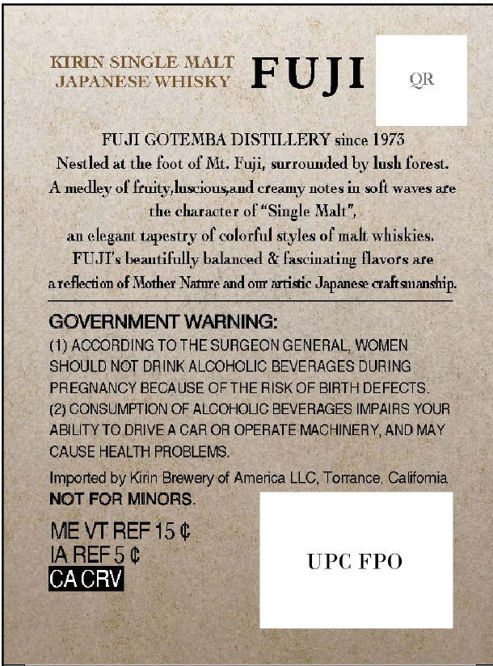
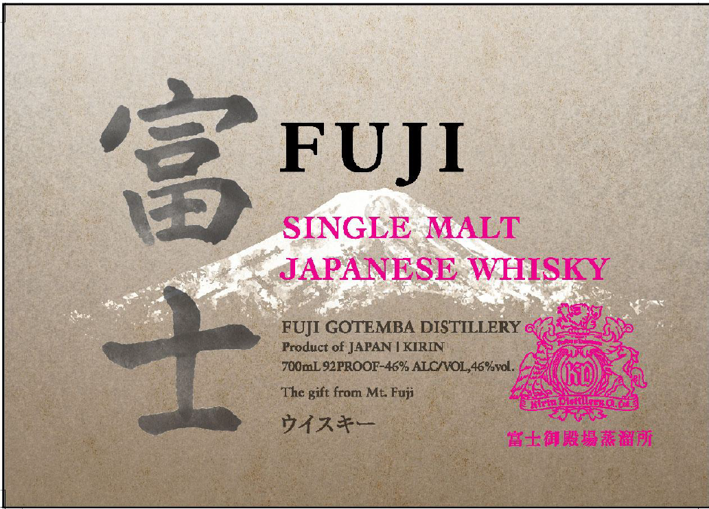

# TTB COLA Label Images - TTBID 26282001000311

**Brand Name:** FUJI

**Fanciful Name:** SINGLE MALT JAPANESE WHISKY

**Issue Date:** 10/16/2026

**Origin Code:** 59

**Product Class/Type:** 118

**Source:** [TTB Public COLA Registry](https://ttbonline.gov/colasonline/viewColaDetails.do?action=publicFormDisplay&ttbid=26282001000311)

## Label Images

### Back Label

### Front Label

## Extracted Label Text

*Text extracted via OCR - may contain errors*

**Detected Proof:** 92

### Back Label

KIRIN SINGLE MALT
JAPANESE WHISKY U J I QR
FUJI GOTEMBA DISTILLERY since 1973
Nestled at the foot of Mt. Fuji, surrounded by lush forest.
A medley of fruity,lusciousand creamy notes in soft waves ate
the character of “Single Malt”,
an elegant tapestry of colorful styles of malt whiskies,
PUM beautifully Lalarcedist Seciusting avers ura
areflection of Mother Nature and onr artistic Japanese craftsmanship.
GOVERNMENT WARNING:
(1) ACCORDING TO THE SURGEON GENERAL, WOMEN
SHOULD NOT DRINK ALCOHOLIC BEVERAGES DURING
PREGNANCY BECAUSE OF THE RISK OF BIRTH DEFECTS
(2) CONSUMPTION OF ALCOHOLIC BEVERAGES IMPAIRS YOUR
ABILITY TG DRIVE A CAR OR OPERATE MACHINERY, AND MAY
CAUSE HEALTH PROBLEMS.
Imported by Kirin Brewery of America LLC, Torrance, Califomia ;
» NOT FOR MINORS.
| MEVTREFI5¢. - }
IAREES Ge 3 UPC FPO
i : sy oe > |
teiots Co ee Ra Cunt ae enc” ek SEE
Pihah eene Mmr eR rec unge eer ks Se ee!

### Front Label

ore Se A OS SRNR AR eae se an PACTS COR OKT Se ota
ee . PAPANESE WHISKY
asm ah eins. nar ion gee S 2. a eles KY |. :
ce ee) SS MI a, eee EG ME
- . ee Na ee Bee tees ee eee
Pe es 7 m FU [1 GOTEMBA DISTILLERY OEE :
———<—< Reco atiapearemeeig enki tacaey emma (ic ans as
Rieter’ eee” © Produc rae se aes Ore
eS eat ei gp reoductof JAPANIKURIN, = ES
ees Fi PROOF 46% ALCO Ai Ge ee ae
PG Or a ae Be ee ee ek INO) 7 ses
‘ 2 BE The gift from Me Foy 37, LRG ONN eo :
: ke, Gee aii other cai ere tay Mies ka gies: bi
3 itteae Gh erie ec peer: seh Sate Te
ee ee | BORE.
