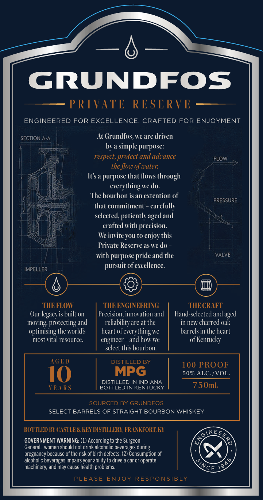
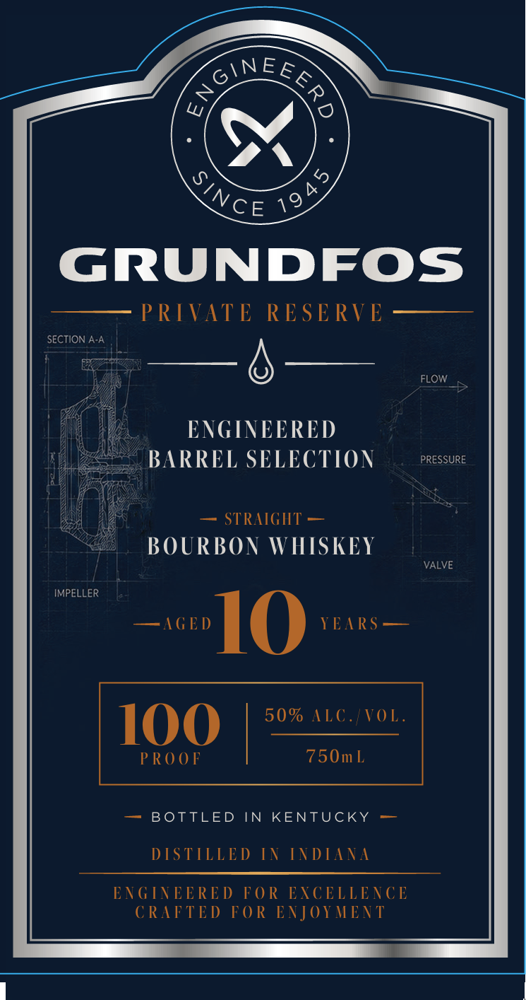

# TTB COLA Label Images - TTBID 26282001000402

**Brand Name:** GRUNDFOS PRIVATE RESERVE

**Issue Date:** 10/16/2026

**Origin Code:** 22

**Product Class/Type:** 101

**Source:** [TTB Public COLA Registry](https://ttbonline.gov/colasonline/viewColaDetails.do?action=publicFormDisplay&ttbid=26282001000402)

## Label Images

### Back Label

### Front Label

## Extracted Label Text

*Text extracted via OCR - may contain errors*

**Detected Proof:** 100

### Back Label

GRUNDFOS
PRIVATE
RE SERVE
ENGINEERED FOR EXCELLENCE
CRAFTED FOR ENJOYMENT
SECTION A-A
At Grundfos, weare driven
bya simple purpose:
respect, protect
advance
FLOW
the floz of zater:
Its a purpose that flows through
everything we do.
Thc bourbon is an eitention of
PRESSURE
that commitment
carefullv
sclected, patiently aged and
crafted with precision:
We invite Tou to
this
Prirate Reserve as we do
with purpose
and thc
VALVE
IMPELLER
pursuit of excellence_
THE FLOW
THE EWGINEERING
THE CRAFT
Our legacy is built on
Precision; innovation and
Hand-selected and
protecting
reliabilitv are at the
in neW charred oak
optimising the worlds
heart of e
feverything=
IC
barrels in the heart
most vital resource
engineer
and how Ie
of Kentucky
sclect this bourbon:
AGE D
DISTILLED BY
100 PROOF
10
MPG
50% ALC /VOL_
DISTILLED IN INDIANA
TEARS
BOTTLED IN KENTUCKY
750mL
SOURCED BY GRUNDFOS
SELECT BARRELS OF STRAIGHT BOURBON WHISKEY
BOTTLED BI (STLE & KEX DISTILLERI,FRANKTORT, KI
INE
E6
GOVERNMENT WARNING: (1) According to the Surgeon
General, women should not drink alcoholic beverages during
pregnancy because of the risk of
detects
2) Consumption of
alcoholic beverages impairs your ability to drive
car or operate
machinery; and may cause health problems:
19
PLEASE ENJOY
RESPONSIBLY
and
enjov-
pride:
Faged
moving,
and
birth
Nce_

### Front Label

ONE&S

VCE 42

GRUNDFOS

PRIVATE

RESERVI

SECTION A

6

FLOW

ENGINEERED

BARREL SELECTION

RESSURE

SSR RALGH I

BOURBON WHISKEY

VE

SO! AUC WOW ALC.

VOL.

100

PROOF

750mL

— BOTTLED IN KENTUCKY —

DISTILLED IN INDIANA

ENGINEERED FOR EXCELLENCE

CRAFTED FOR ENJOYMENT
