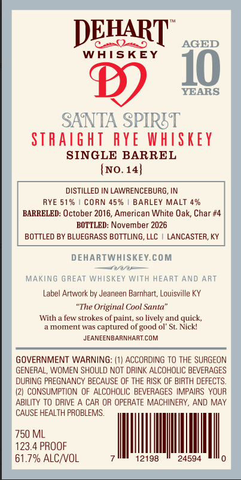
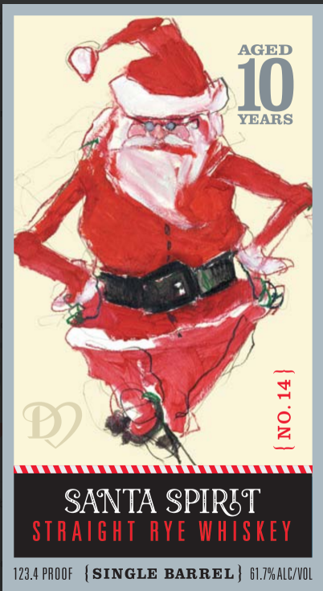

# TTB COLA Label Images - TTBID 26282001000409

**Brand Name:** SANTA SPIRITS

**Issue Date:** 10/19/2026

**Origin Code:** 22

**Product Class/Type:** 102

**Source:** [TTB Public COLA Registry](https://ttbonline.gov/colasonline/viewColaDetails.do?action=publicFormDisplay&ttbid=26282001000409)

## Label Images

### Back Label

### Front Label

## Extracted Label Text

*Text extracted via OCR - may contain errors*

**Detected Proof:** 123.4
**Detected Age:** 10 Years

### Back Label

DEHART
205
AGED
WAISKEY
10
YEARS
SANTA SPIRET
STRAIght RYE WhiSkey
SINGLE BARREL
(No.14}
DISTILLED IN LAWRENCEBURG
RYE 51%
CoRN 45 %
BARLEY MALT 4%
BARRELED: October 2016, American White Oak; Char #4
BOTTLED: November 2026
BOTTLED BY BLUEGRASS BOTTLING, LLC
LANCASTER, KY
DEHARTWHISKEY.COM
Daon
MAKING GREAT WHISKEY With HEART ANd ART
Label Artwork by Jeaneen Barnhart; Louisville KY
"The Original Cool Santa'
With
lew strokes ol paint, s0 lively and quick,
a moment was
captured of good ol' St: Nickl
JEANEENBARNHARTCOM
GOVERNMENT WARNING: (1| ACCORDING TO THE SURGEON
GENERAL, WOMEN SHOULD NOT DRINK ALCOHOLIC BEVERAGES
DURING PREGNANCY BECAUSE OF THE RISK OF BIRTH DEFECTS.
consuMPTION OF ALCOHOLIC BEVERAGES IMPAIRS YOUR
ABILITY TO ORIVE
CAR OR OPERATE MACHINERY,
AND MAY
CAUSE HEALTH PROBLEMS .
750 ML
123.4 PROOF
61.7% ALCNVOL
12198
24594

### Front Label

AGED
10
YEARS
8
SANTA SPIRST
STRAtght
RYE WHISKey
123.4 PROOF
SINGLE BARREL
61.79 ALC/VOL
