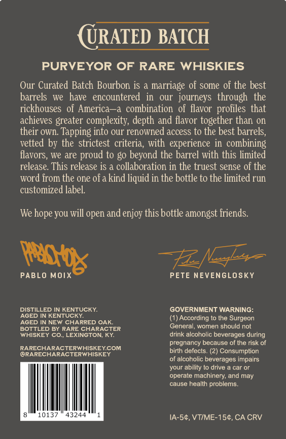

# TTB COLA Label Images - TTBID 26282001000412

**Brand Name:** RARE CHARACTER

**Issue Date:** 10/19/2026

**Origin Code:** 22

**Product Class/Type:** 102

**Source:** [TTB Public COLA Registry](https://ttbonline.gov/colasonline/viewColaDetails.do?action=publicFormDisplay&ttbid=26282001000412)

## Label Images

### Back Label

### Front Label

### Label 3

## Extracted Label Text

*Text extracted via OCR - may contain errors*

*1 image(s) excluded: text did not meet readability threshold*

**Detected Age:** 10 Years

### Back Label

URATED BATCH
PURVEYOR OF
RARE WHISKIES
Our Curated Batch Bourbon is
marriage of some of the best
barrels
we   have   encountered
OUI   journeys   through   the
rickhouses of America -a combination of flavor profiles that
achieves greater complexity, depth and flavor together than on
their own: Tapping into our renowned access to the best barrels;
vetted by the strictest criteria, with   experience in   combining
flavors;
we are proud to g0 beyond the barrel with this limited
release. This release is & collaboration in the truest sense of the
word from the one ofa kind liquid in the bottle to the limited run
customized label
We hope you will open and enjoy this bottle amongst iriends.
PABLO MOIX
PETE NEVENGLOSKY
DISTILLED IN KENTUCKY:
GOVERNMENT WARNING:
AGED IN KENTUCKY
(1) According to the Surgeon
AGED IN NEW CHARRED OAK
BOTTLED BY RARE CHARACTER
General; women should nol
WHISKEY CO
LEXINGTON; KY
drink alcoholic beverages during
pregnancy because of the risk of
RARECHARACTERWHISKEYCOM
@RARECHARACTERWHISKEY
birth defects
Consumption
of alcoholic beverages impairs
your ability t0 drive
car or
operate machinery; and may
cause health problems_
10137
43244
IA-54, VTIME-1Sc,CA CRV
psb

### Front Label

RARE
C HARACTE R
CURATE D
BATCH
SELECTED BY
AMERICAN?
BATCH
NO.
RELEASED YEAR
PROOF
BOTTLE NO:
0
202t
123
801
ALC
61.57
BY VOL
KenTucky STRAIGHT RYE WHISKEY
A MARRIAGE OF 7-10 YEAR OLD RYES
CASK STRENGTH
75OML
