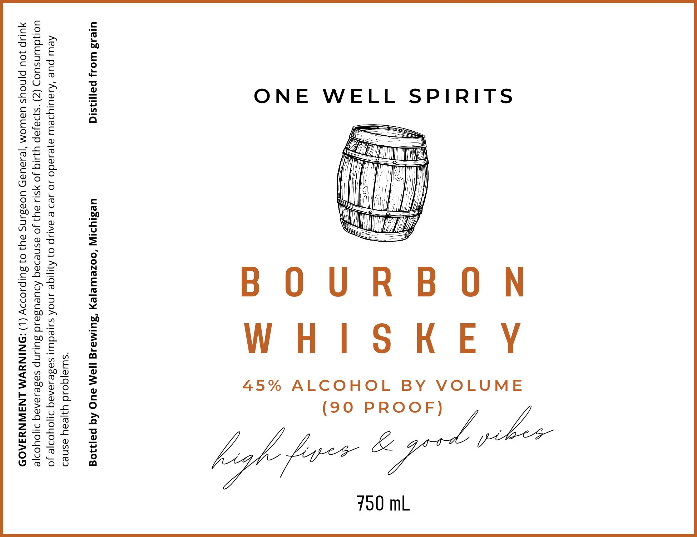

# TTB COLA Label Images - TTBID 26282001000414

**Brand Name:** ONE WELL SPIRITS

**Fanciful Name:** ONE WELL BOURBON

**Issue Date:** 10/20/2026

**Origin Code:** 06

**Product Class/Type:** 141

**Source:** [TTB Public COLA Registry](https://ttbonline.gov/colasonline/viewColaDetails.do?action=publicFormDisplay&ttbid=26282001000414)

## Label Images

### Label 1

## Extracted Label Text

*Text extracted via OCR - may contain errors*

**Detected Proof:** 90

### Label 1

SEE of
Fee @
Sos .
24s 8
gos 3 ONE WELL SPIRITS
aay frre IT
55 O° I
ots Raul | Hi
gee § COT
cos id
ere BOURBON
9 fs —_=
cas =
ZOgE =
Iga
S258 § 45% ALCOHOL BY VOLUME
ooa ¢f
Gece 8 (90 PROOF) hee
Socg 2
e=zcec Ss 7
pi hgh foe opt
OUT °
Ow oO” a
750 mL
