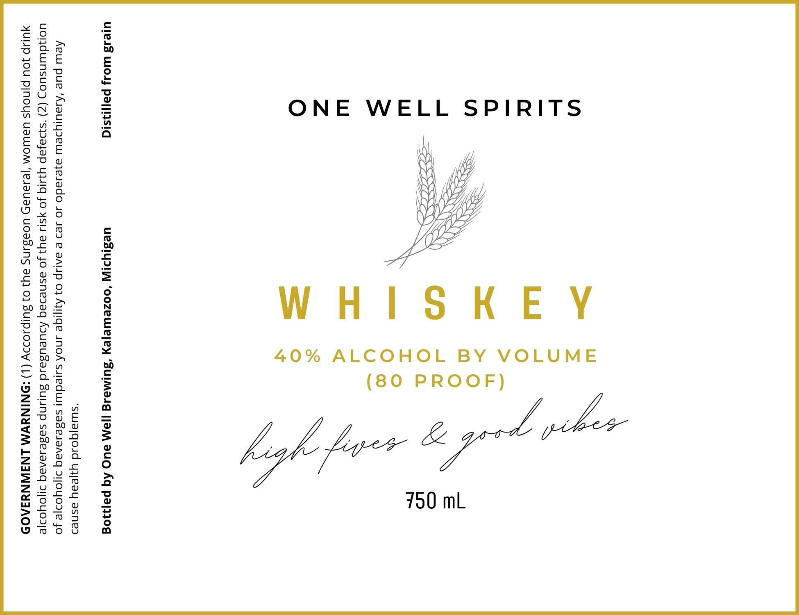

# TTB COLA Label Images - TTBID 26282001000458

**Brand Name:** ONE WELL SPIRITS

**Issue Date:** 10/19/2026

**Origin Code:** 06

**Product Class/Type:** 140

**Source:** [TTB Public COLA Registry](https://ttbonline.gov/colasonline/viewColaDetails.do?action=publicFormDisplay&ttbid=26282001000458)

## Label Images

### Label 1

## Extracted Label Text

*Text extracted via OCR - may contain errors*

**Detected Proof:** 80

### Label 1

ONE WELL SPIRITS
WHISKEY
(80 PROOF)

40% ALCOHOL BY VOLUME

N
x
‘

uje4s3 Woy pali3sid uesIyriW ‘oozeweyey ‘Suima.g |[aM 2UC Aq pajj30g

“suua}qoid yyeay asned

Aew pue ‘Ajaulydew a}esado Jo sed © BALIP 07 Aqiqe UNOA suleduu| sasesanaq IOYOosIe Jo
uonduinsuos (Z) s}aJap YUIG JO ySI4 ay} Jo asnedaq ADUeUZIId SULNP SaBesaAaq I|OYor|e
UIP JOU PjnoYs UaWOM ‘|eJaUaDH UOSBINS ay} 0} SUIPJOIIY (L) -ONINUWM LNJWNYIAOD
