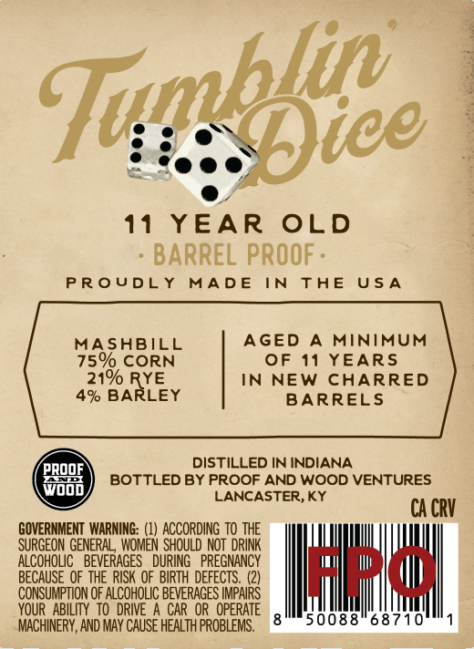
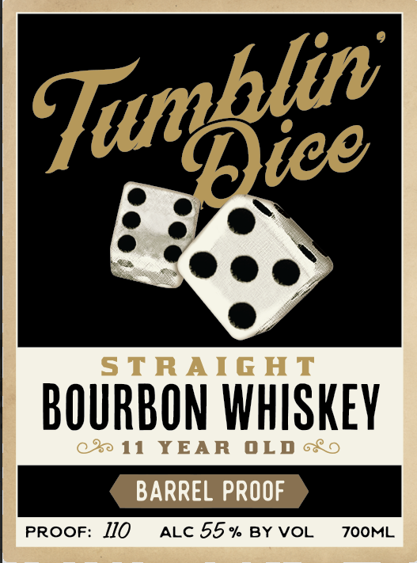

# TTB COLA Label Images - TTBID 26282001000460

**Brand Name:** TUBLIN DICE

**Issue Date:** 10/16/2026

**Origin Code:** 22

**Product Class/Type:** 101

**Source:** [TTB Public COLA Registry](https://ttbonline.gov/colasonline/viewColaDetails.do?action=publicFormDisplay&ttbid=26282001000460)

## Label Images

### Back Label

### Front Label

### Label 3

## Extracted Label Text

*Text extracted via OCR - may contain errors*

*1 image(s) excluded: text did not meet readability threshold*

**Detected Age:** 11 Years

### Back Label

11
YEAR
OLD
BARREL PROOF =
PR oUDL Y
MAD E
IN
TAE
U$ A
MASABILL
AGED
MInIMUM
75% CORN
OF 11
YEARS
210 RYE
IN
NEW
CHARRED
49 BARLEY
BARRELS
PROOF
DISTILLED IN INDIANA
BOTTLED BY PROOF AND WOOD VENTURES
Wood
LANCASTER,KY
CA CRV
GOVERNMENT WARNING:
ACCORDING TO THE
SURGEON GENERAL , WOMEN  SHOULD NOT  DRINK
AlcohoLIc   BEVERAGES   DURING  PREGNANCY
BECAUSE OF THE  RISK OF BIRTH DEFECTS.
J4
CONSUMPTION OF ALCOHOLIC BEVERAGES IMPAIRS
YOUR   ABILITY TO  DRIVE A CAR OR  OPERATE
MACHINERY, AND MAY CAUSE HEALTH PROBLEMS.
50088"687
Tuofice

### Front Label

STRAIGHT

BOURBON WHISKEY

11 YEAR OLD <o

BARREL PROOF

PROOF: IJO atc 55% BYVOL 700ML
