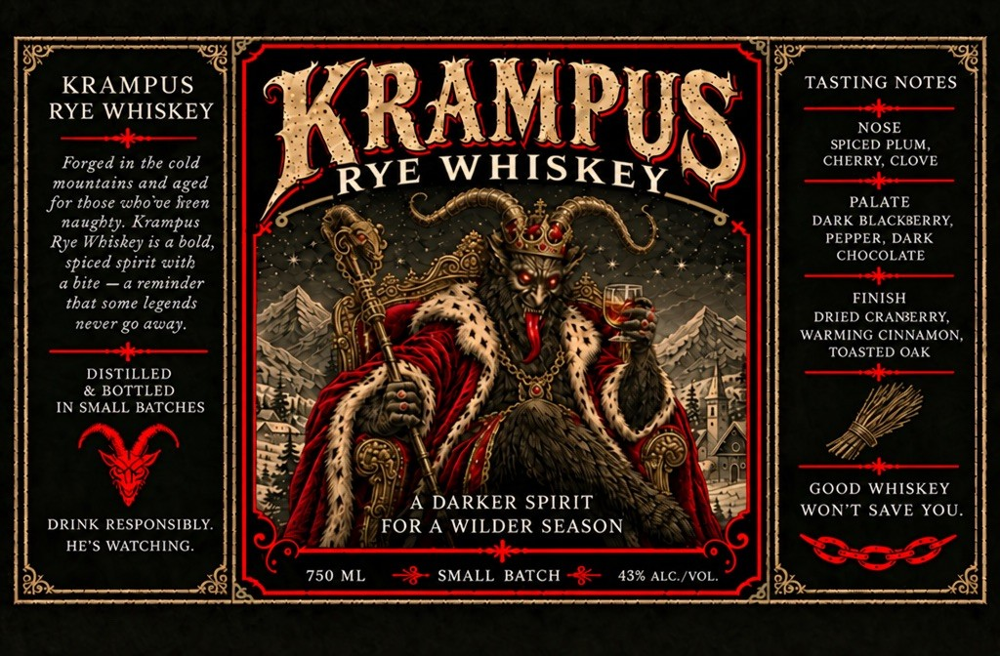

# TTB COLA Label Images - TTBID 26282001000485

**Brand Name:** KRAMPUS RYE WHISKEY

**Issue Date:** 10/16/2026

**Origin Code:** 03

**Product Class/Type:** 142

**Source:** [TTB Public COLA Registry](https://ttbonline.gov/colasonline/viewColaDetails.do?action=publicFormDisplay&ttbid=26282001000485)

## Label Images

### Back Label

### Front Label

## Extracted Label Text

*Text extracted via OCR - may contain errors*

**Detected Proof:** 86

### Back Label

GOVERNMENT WARNING: (1) ACCORDING TO THE
SURGEON GENERAL, WOMEN SHOULD NOT DRINK
ALCOHOLIC BEVERAGES DURING PREGNANCY BECAUSE
OF THE RISK OF BIRTH DEFECTS. (2) CONSUMPTION OF
ALCOHOLIC BEVERAGES IMPAIRS YOUR ABILITY TO DRIVE
CAR OR OPERATE MACHINERY, AND MAY CAUSE
HEALTH PROBLEMS:
Produced, Blended & Bottled by
The Distillery at Lambertville
5 South Main Street
Lambertviller; NJ 08530

### Front Label

KRAMPUS
TASTING NOTES
RYE WHISKEY
KRAMPUS
NOSE
SPICED PLUM;
Forged in the cold
WHISKEY
CHERRY, CLOVE
mountains and
for those cbo ve Freen
PALATE
naughty: Krampus
DARK BLACKBERRY
Rye Whiskey is a bold,
PEPPER
DARK
spiced spirit with
CHOCOLATE
bite
a reminder
that some legends
FINISH
DRIED CRANBERRY,
never g0 away:
WARMING CINNAMON,
TOASTED OAK
DISTILLED
& BOTTLED
IN SMALL BATCHES
GOOD WHISKEY
DARKER SPIRIT
WON'T SAVE YOU_
DRINK RESPONSIBLY
FOR A WILDER SEASON
HE'$ WATCHING.
808
750 ML
SMALL BATCH
43% ALC /VOL.
RYE
aged
