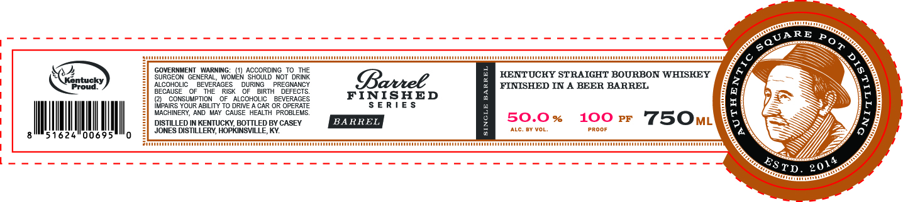
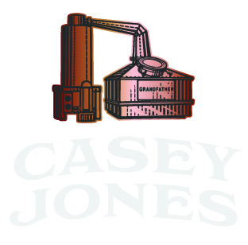

# TTB COLA Label Images - TTBID 26282001000486

**Brand Name:** CASEY JONES

**Fanciful Name:** BARREL FINISHED SERIES

**Issue Date:** 10/16/2026

**Origin Code:** 22

**Product Class/Type:** 101

**Source:** [TTB Public COLA Registry](https://ttbonline.gov/colasonline/viewColaDetails.do?action=publicFormDisplay&ttbid=26282001000486)

## Label Images

### Label 1

### Label 2

### Label 3

## Extracted Label Text

*Text extracted via OCR - may contain errors*

*2 image(s) excluded: text did not meet readability threshold*

### Label 1

GOVERNMENT WARNING: (1) ACCORDING TO THE
SURGEON GENERAL, WOMEN SHOULD NOT DRINK
ALCOHOLIC BEVERAGES DURING PREGNANCY
BECAUSE OF THE RISK OF BIRTH DEFECTS,
() CONSUMPTION OF ALCOHOLIC BEVERAGES
IMPAIRS YOUR ABILITY TO DRIVE A CAR OR OPERATE
MACHINERY, AND MAY CAUSE HEALTH PROBLEMS,

DISTILLED IN KENTUCKY, BOTTLED BY CASEY
JONES DISTILLERY, HOPKINSVILLE, KY.

KENTUCKY STRAIGHT BOURBON WHISKEY
FINISHED IN A BEER BARREL

&
mn

th]

50.0% 100rrF FJ5Om

8
