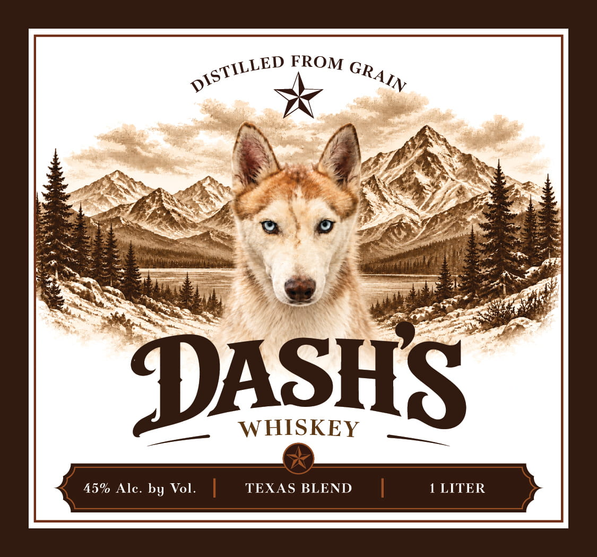
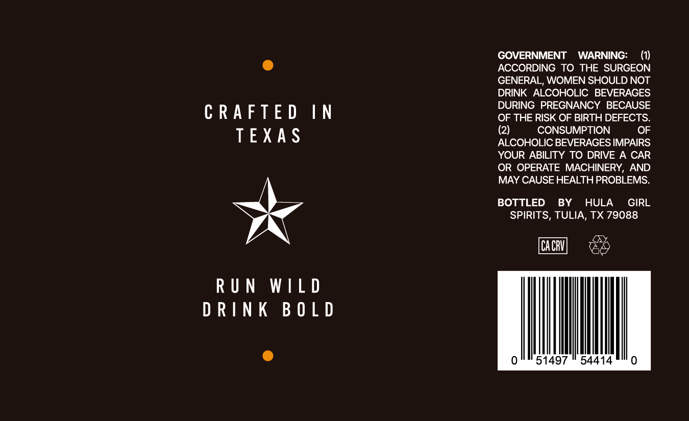

# TTB COLA Label Images - TTBID 26282001000492

**Brand Name:** DASH'S WHISKEY

**Issue Date:** 10/19/2026

**Origin Code:** 44

**Product Class/Type:** 137

**Source:** [TTB Public COLA Registry](https://ttbonline.gov/colasonline/viewColaDetails.do?action=publicFormDisplay&ttbid=26282001000492)

## Label Images

### Label 1

### Label 2

## Extracted Label Text

*Text extracted via OCR - may contain errors*

**Detected Proof:** 90

### Label 1

FROM
DASHS
WHISKEY
45% Alc. by Vol_
TEXAS BLEND
1 LITER
DISTILLED
GRAIN

### Label 2

GOVERNMENT WARNING:

(1)

@

ACCORDING TO THE SURGEON

GENERAL, WOMEN SHOULD NOT

DRINK ALCOHOLIC BEVERAGES

DURING PREGNANCY BECAUSE

CRAFTED

IN

OF THE RISK OF BIRTH DEFECTS.

(2)

CONSUMPTION

OF

TEXAS

ALCOHOLIC BEVERAGES IMPAIRS

YOUR ABILITY TO DRIVE A CAR

OR OPERATE MACHINERY, AND

MAY CAUSE HEALTH PROBLEMS.

BOTTLED BY HULA GIRL

SPIRITS, TULIA, TX 79088

CACRY

&

RUN WILD

DRINK BOLD

@

497 | 54414
