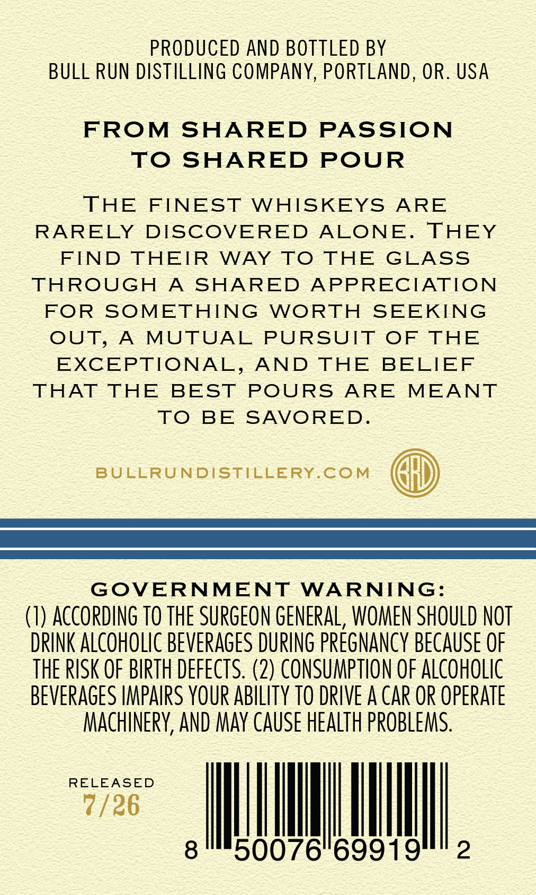
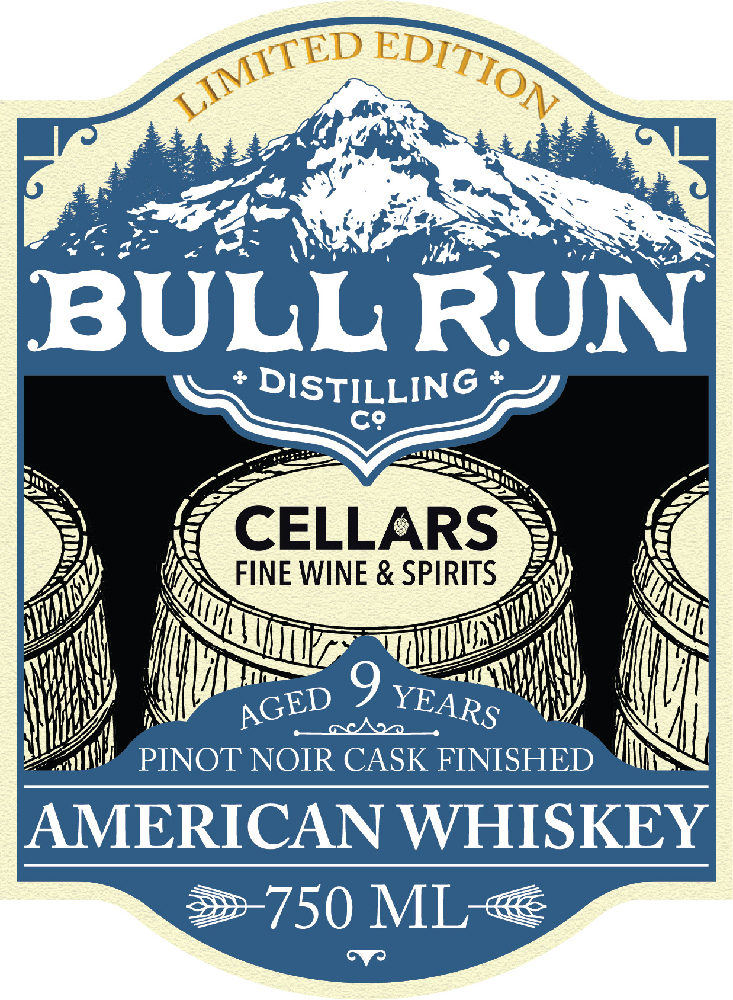
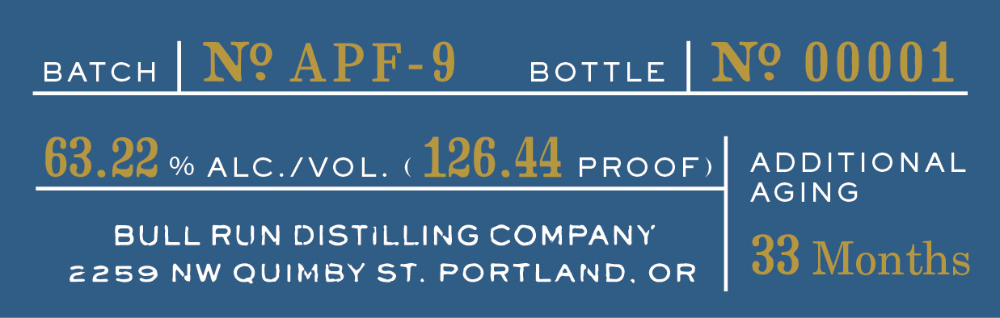
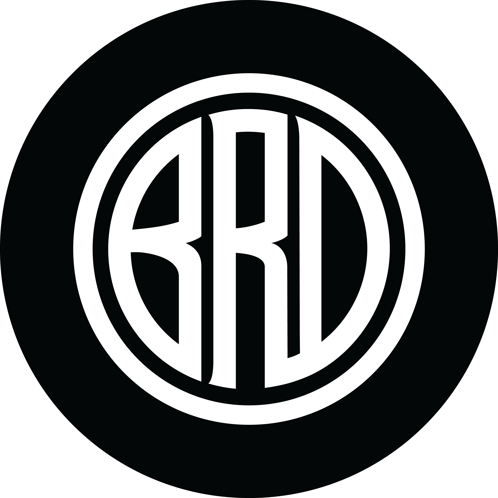

# TTB COLA Label Images - TTBID 26282001000509

**Brand Name:** BULL RUN DISTILLING CO.

**Fanciful Name:** CELLARS FINE WINE & SPIRITS

**Issue Date:** 10/16/2026

**Origin Code:** 38

**Product Class/Type:** 140

**Source:** [TTB Public COLA Registry](https://ttbonline.gov/colasonline/viewColaDetails.do?action=publicFormDisplay&ttbid=26282001000509)

## Label Images

### Back Label

### Front Label

### Label 2

### Label 4

## Extracted Label Text

*Text extracted via OCR - may contain errors*

*1 image(s) excluded: text did not meet readability threshold*

### Back Label

PRODUCED AND BOTTLED BY
BULL RUN DISTILLING COMPANY, PORTLAND , OR. USA
FROM
SHARED
PASSION
TO
SHARED
POUR
THE
FINEST
WHISKEYS
ARE
RARELY
DISCOVERED
ALONE.
THEY
FIND THEIR
WAY
To
THE
GLAss
THROUGH
A
SHARED
APPRECIATION
FOR
SOMETHING
WORTH
SEEKING
OUT,
A
MUTUAL
PURSUIT
OF
THE
EXCEPTIONAL,
AND
THE
BELIEF
THAT
THE
BEST
POURS
ARE
MEANT
TO
BE
SAVORED.
BULLRUNDISTILLERY.CoM
GOVERNMENT
WARNING:
(7) ACcORding TO THE SURGEON GENERAL, WOMEN SHOULD NOT
DRINK ALCOHOLIC BEVERAGES DURING PREGNANCY BECAUSE OF
THE RISK OF BIRTH defects: (2) CONSUMPTION OF ALCOHOLIC
BEVERAGES IMPAIRS YOUR ABILITy TO DRIVE A Car OR OPERATE
MAChiNERY, AND MAY CAUSE HEALTh PROBLEMS:
RELEASED
7/26
8
50076"69919
2

### Front Label

BULL RUN
DISTILLING
C9
CELLARS
FINE WINE & SPIRITS
Dw
9
aCAxo_
PINOT NOIR CASK FINISHED
AMERICAN WHISKEY
750 ML
LIMITED
EDITION
YEARS
AGED

### Label 2

BATCH N° APF-9 BOTTLE N° 00001
63.22 % acc.voc. (126.44 proor)| ADDITIONAL
AGING
BULL RUN DISTILLING COMPANY
2259 NW QUIMBY ST. PORTLAND. OR 33 Months
