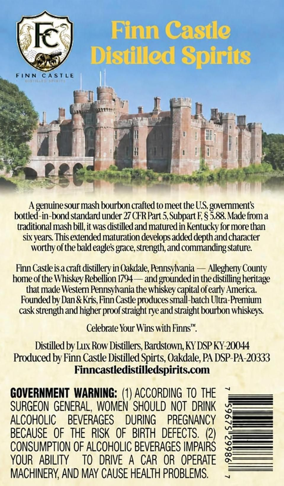
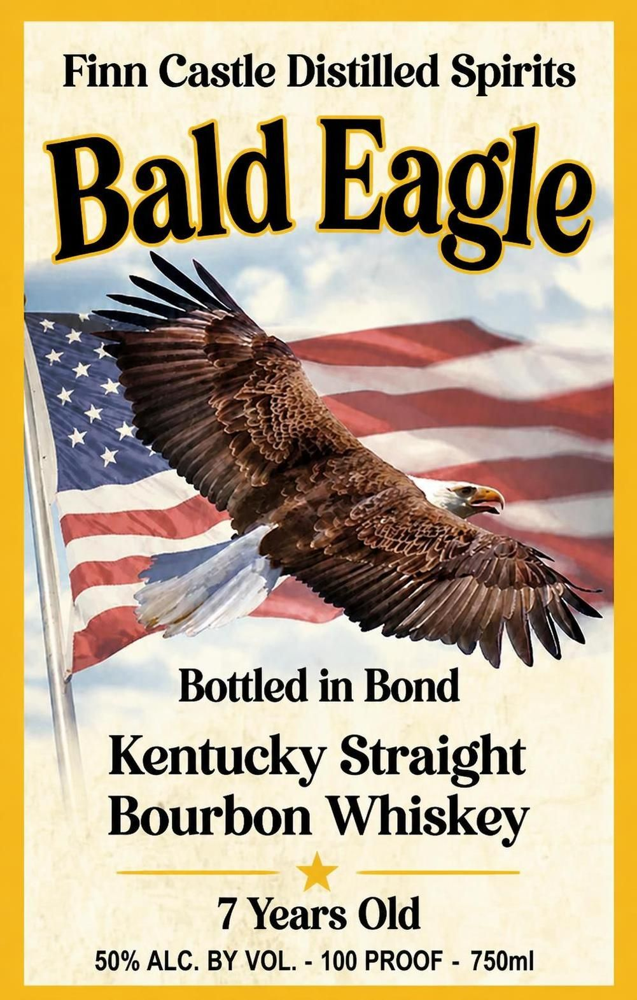

# TTB COLA Label Images - TTBID 26282001000547

**Brand Name:** FINN CASTLE DISTILLED SPIRITS

**Fanciful Name:** BALD EAGLE 
BOTTLED IN BOND
KENTUCKY STRAIGHT BOURBON WHISKEY

**Issue Date:** 10/23/2026

**Origin Code:** 39

**Product Class/Type:** 111

**Source:** [TTB Public COLA Registry](https://ttbonline.gov/colasonline/viewColaDetails.do?action=publicFormDisplay&ttbid=26282001000547)

## Label Images

### Back Label

### Label 1

## Extracted Label Text

*Text extracted via OCR - may contain errors*

**Detected Proof:** 100
**Detected Age:** 7 Years

### Back Label

R
Finn Caste
Distilled Spirits
FINN
C^STLE
6'$ ^ (L ^ |'
A
genuinesour mash bourbon crafted to meet theUS
bottled-in-bndstandard under 27 CFR Part 5,Subpart E $
goernncetto
Made fiom a
traditional mash bill,it was distilled and matured in Kentucky for more than
sixyears This extended maturation develops added depth and character
worthy of thebald eagles grace; strength; and commanding Stature
Finn Castleisa cralt distilleryin Oakdale; Pennsylvania
Allegheny County
home of the Whiskey Rebellion 1794
andgroundedin thedistllingheritage
that made Western Pennsylania the whiskey capital of early America:
Foundexl by Dan & Kris, Finn Castle produces small-batch Ultra-Premium
cask strength and higher
straight ryeand straight bourbon whiskeys
Celebrate Your Wins with Finns".
Distilled by Lux Row Distillers, Bardstown; KY DSP KY-20044
Produced by Finn Castle Distilled Spirts; Oakdale; PA DSP-PA-20333
Finncastledistilledspiritscom
GOVERNMENT  WARNING: (1) ACCORDING  TO THE
SURGEON  GENERAL, WOMEN' SHOULD NOT   DRINK
ALCOHOLIC
BEVERAGES
DURING
PREGNANCY
BECAUSE   OF   THE  RISK   OF   BIRTH  DEFECTS.
(2)

CONSUMPTION OF ALCOHOLIC BEVERAGES IMPAIRS
YOUR   ABILITY
To   DRIVE
A
CAR  OR  OPERATE
MACHINERY, AND MAY CAUSE HEALTH PROBLEMS.
proof _

### Label 1

Finn Castle Distilled Spirits
Bald Eagle
Bottled in Bond
Kentucky Straight
Bourbon
Whiskey
7 Years Old
50% ALC. BY VOL.
100 PROOF
750ml
