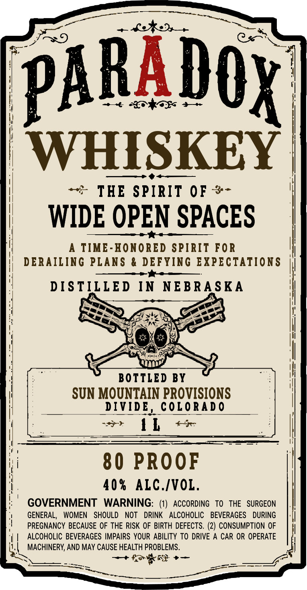

# TTB COLA Label Images - TTBID 26282001000583

**Brand Name:** PARADOX WHISKEY

**Issue Date:** 10/16/2026

**Origin Code:** 13

**Product Class/Type:** 140

**Source:** [TTB Public COLA Registry](https://ttbonline.gov/colasonline/viewColaDetails.do?action=publicFormDisplay&ttbid=26282001000583)

## Label Images

### Label 1

## Extracted Label Text

*Text extracted via OCR - may contain errors*

**Detected Proof:** 80

### Label 1

PARAdOX
WHISKEY
THE SPIRIT 0F
WIDE OPEN SPACES
TIME-HONORED SPIRIT FOR
DERAILING PLANS
DEFYING FXPECTATIONS
D [ S TILLED
IN
NEBRA SKA
BOTTLED BY
SUN MOUNTAIN PROVISIONS
DIVIDE
COLo Ra d 0
1L
80 PROOF
40 %
ALC.IVOL.
GOVERNMENT
WARNING: (1) ACCORDING
To
THE   SURGEON
GENERAL,
WOMEN
SHOULD
NOT
DRINK
ALCOHOLIC
BEVERAGES
DURING
PREGNANCY BECAUSE OF THE RISK OF BIRTH DEFECTS. (2) CONSUMPTION OF
ALCOHOLIC BEVERAGES IMPAIRS YOUR ABILITY TO DRIVE A
CAR OR OPERATE
MACHINERY; AND MAY CAUSE HEALTH PROBLEMS.
