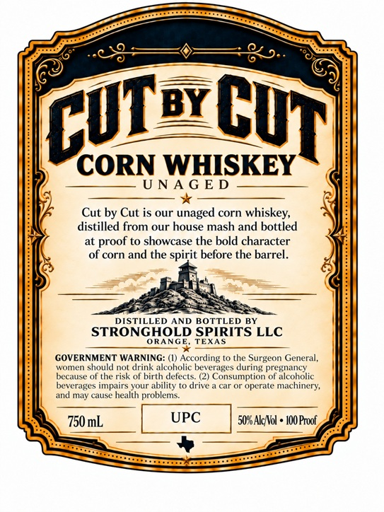
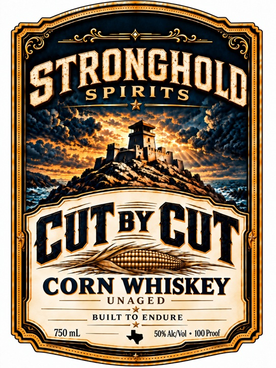

# TTB COLA Label Images - TTBID 26283001000024

**Brand Name:** STRONGHOLD SPIRITS

**Fanciful Name:** CUT BY CUT

**Issue Date:** 10/16/2026

**Origin Code:** 44

**Product Class/Type:** 143

**Source:** [TTB Public COLA Registry](https://ttbonline.gov/colasonline/viewColaDetails.do?action=publicFormDisplay&ttbid=26283001000024)

## Label Images

### Back Label

### Front Label

## Extracted Label Text

*Text extracted via OCR - may contain errors*

**Detected Proof:** 100

### Back Label

8 0.
BY
CORN WHISKEY
U NA G E D
Cut by Cut is our unaged corn
whiskey,
distilled from our house mash and bottled
at proof t0 showcase the bold character
of corn and the spirit before the barrel:
DISTILLED AND
BOTTLED BY
STRONGHOLD SPIRITS LLC
ORANGE
TEXAS
GOVERNMENT WARNING: (I) According to the
Surgeon General,
Wvomcm
should not drink alcoholic beverages curing pregnancy
because of the risk of birth defects (2) Consumption of alcoholic
beverages impairs your ability to drive
car Or operate
machinery,
and may cause health problems:
750 mL
UPC
508 AkcNol
100 Prol
CUT
Cut

### Front Label

S
430
STRONGHOLD
S PIRITS
BY
CORN WHISKEY
UNAG E D
BUILT TO ENDURE
750 mL
50% AlcNol
10O Proof
CuJ
Cut
