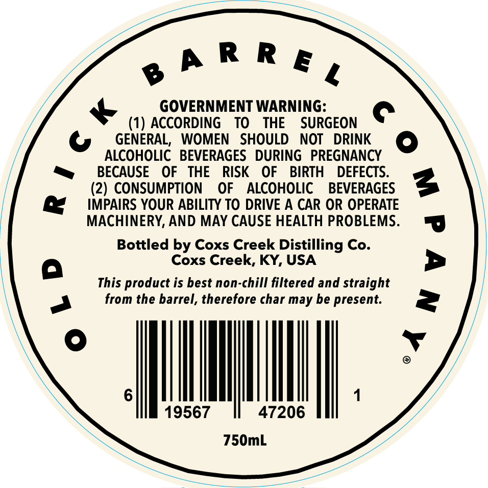
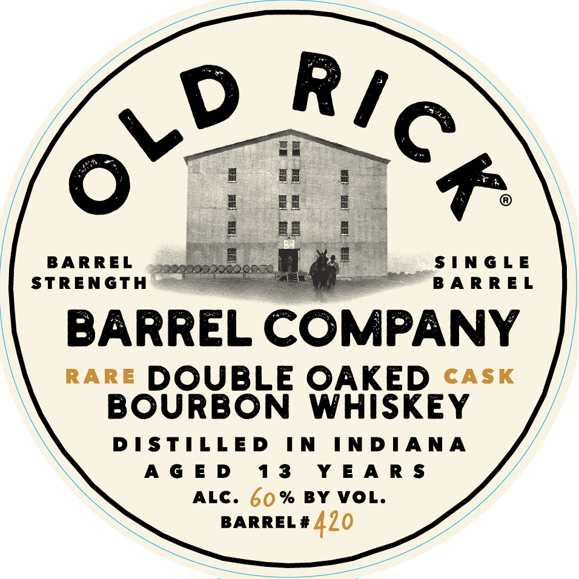

# TTB COLA Label Images - TTBID 26283001000030

**Brand Name:** OLD RICK

**Fanciful Name:** DOUBLE OAKED RARE CASK

**Issue Date:** 10/19/2026

**Origin Code:** 22

**Product Class/Type:** 141

**Source:** [TTB Public COLA Registry](https://ttbonline.gov/colasonline/viewColaDetails.do?action=publicFormDisplay&ttbid=26283001000030)

## Label Images

### Back Label

### Front Label

## Extracted Label Text

*Text extracted via OCR - may contain errors*

**Detected Age:** 13 Years

### Back Label

ehR Re,

GOVERNMENT WARNING:

(1) ACCORDING TO THE SURGEON

ec

GENERAL, WOMEN SHOULD NOT DRINK

Jeo

ALCOHOLIC BEVERAGES DURING PREGNANCY

fe)

~

BECAUSE OF THE RISK OF BIRTH DEFECTS.

(2) CONSUMPTION OF ALCOHOLIC BEVERAGES

IMPAIRS YOUR ABILITY TO DRIVE A CAR OR OPERATE

MACHINERY, AND MAY CAUSE HEALTH PROBLEMS.

Bottled by Coxs Creek Distilling Co.

Coxs Creek, KY, USA

This product is best non-chill filtered and straight

from the barrel, therefore char may be present.

a

MN

19567

47206

|

750mL

### Front Label

R7

VD

-

STRENGT

BARREL

SINGLE

ARREL

BARREL COMPANY

rare DOUBLE OAKED <aAs«

BOURBON WHISKEY

DISTILLED IN INDIANA

AGED

13 YEARS

ALC. 60% BY VOL.

BARREL # {70

BOSS
