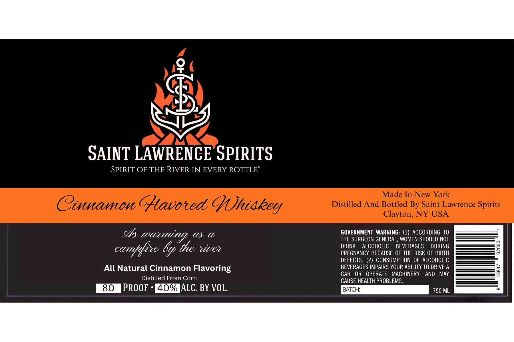

# TTB COLA Label Images - TTBID 26283001000043

**Brand Name:** SAINT LAWRENCE SPIRITS

**Fanciful Name:** CINNAMON

**Issue Date:** 10/20/2026

**Origin Code:** 02

**Product Class/Type:** 149

**Source:** [TTB Public COLA Registry](https://ttbonline.gov/colasonline/viewColaDetails.do?action=publicFormDisplay&ttbid=26283001000043)

## Label Images

### Label 1

## Extracted Label Text

*Text extracted via OCR - may contain errors*

**Detected Proof:** 80

### Label 1

SAINT LAWRENCE SPIRITS
SPIRIT OF THE RIVER IN EVERY BOTTLE"
Made In New York
Cinnamon Gtavoted Chiakey
Distilled And Bottled By Saint Lawrence Spirits
Clayton, NY USA
waeing ,
as
C
GOVERNMENT  WARNING: (1) ACCORDING TO
THE SURGEON GENERAL, WOMEN SHOULD NOT
6y the %rvee
DRINK
ALCOHOLIC
BEVERAGES
DURING
3
PREGNANCY BECAUSE OF THE RISK OF BIRTH
DEFECTS .
(2) CONSUMPTION OF ALCOHOLIC
All Natural Cinnamon Flavoring
BEVERAGES IMPAIRS YOUR ABILITY TO DRIVE A
3
CAR
OR
OPERATE
MACHINERY,
AND
MAY
Distilled From Corn
CAUSE HEALTH PROBLEMS.
80
PROOF
4O% ALC. BY VOL.
BATCH:
750 ML
canffice
