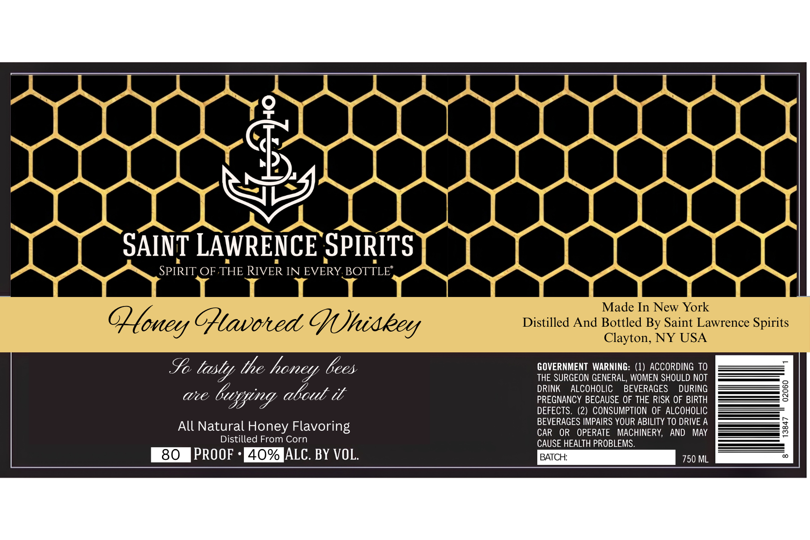

# TTB COLA Label Images - TTBID 26283001000046

**Brand Name:** SAINT LAWRENCE SPIRITS

**Fanciful Name:** HONEY

**Issue Date:** 10/20/2026

**Origin Code:** 02

**Product Class/Type:** 149

**Source:** [TTB Public COLA Registry](https://ttbonline.gov/colasonline/viewColaDetails.do?action=publicFormDisplay&ttbid=26283001000046)

## Label Images

### Label 1

## Extracted Label Text

*Text extracted via OCR - may contain errors*

**Detected Proof:** 80

### Label 1

90
SAINT LAWRENCE SPIRITS
SPIRIT OF THE RIVER IN EVERY BOTTLE'
Made In New York
Qoney Ghtavoted Ghidkey
Distilled And Bottled By Saint Lawrence Spirits
Clayton, NY USA
Sa tasty the honey bees
GOVERNMENT  WARNING: (1) ACCORDING TO
THE SURGEON GENERAL, WOMEN SHOULD NOT
Ute;
busying abcut i
DRINK
ALCOHOLIC
BEVERAGES
DURING
3
PREGNANCY BECAUSE OF THE RISK OF BIRTH
DEFECTS .
(2) CONSUMPTION OF ALCOHOLIC
BEVERAGES IMPAIRS YOUR ABILITY TO DRIVE A
All Natural Honey Flavoring
CAR
OR
OPERATE
MACHINERY,
AND
MAY
3
Distilled From Corn
CAUSE HEALTH PROBLEMS.
80
PROOF
40% ALC. BY VOL.
BATCH:
750 ML
