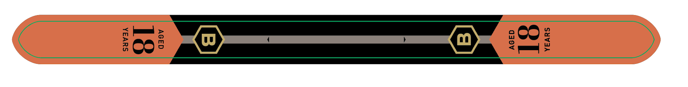
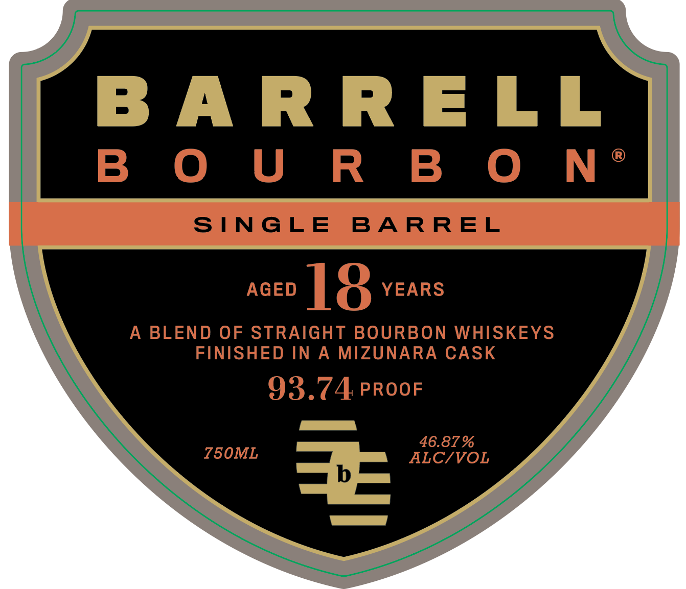

# TTB COLA Label Images - TTBID 26284001000022

**Brand Name:** BARRELL BOURBON

**Issue Date:** 10/19/2026

**Origin Code:** 22

**Product Class/Type:** 121

**Source:** [TTB Public COLA Registry](https://ttbonline.gov/colasonline/viewColaDetails.do?action=publicFormDisplay&ttbid=26284001000022)

## Label Images

### Back Label

### Front Label

## Extracted Label Text

*Text extracted via OCR - may contain errors*

*1 image(s) excluded: text did not meet readability threshold*

**Detected Proof:** 93.7
**Detected Age:** 18 Years

### Front Label

B ARR ELL
B  0 U R B 0 N
SINGLE
BA RREL
AGED
18
YEARS
A
BLEND OF STRAIGHT BOURBON WHISKEYS
FINISHED IN
A
MIZUNARA
CASK
93.74 PROOF
46.87 %
750ML
ALC/VOL
3
