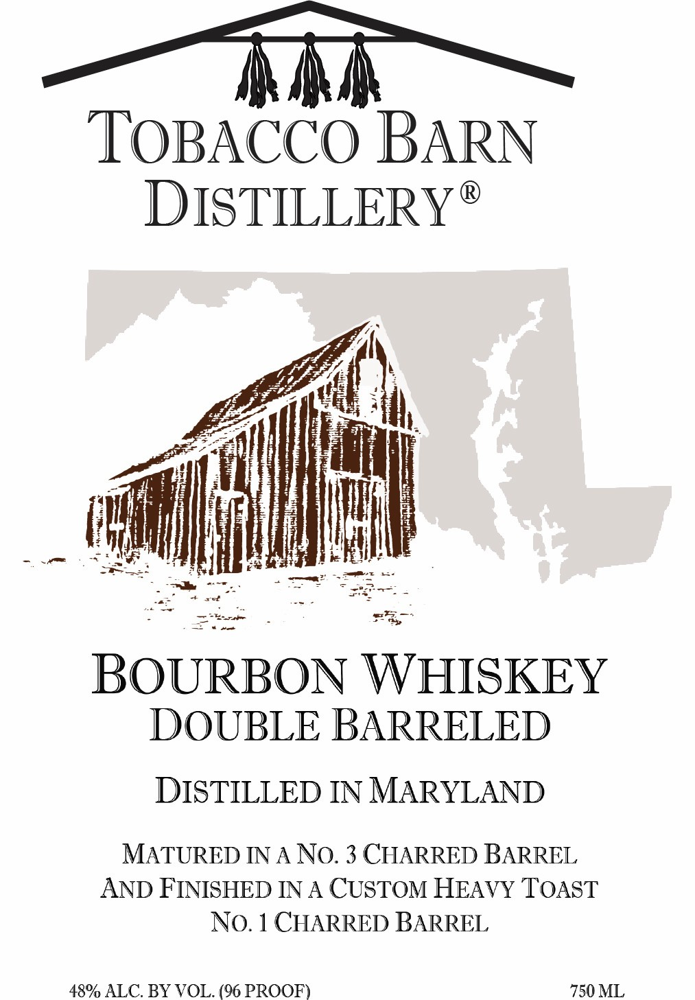
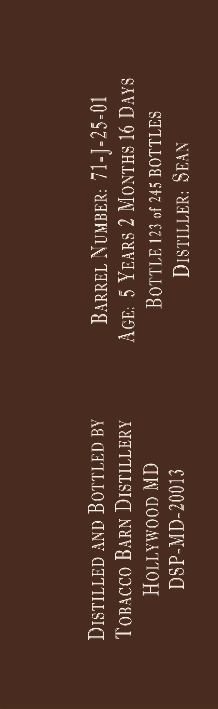
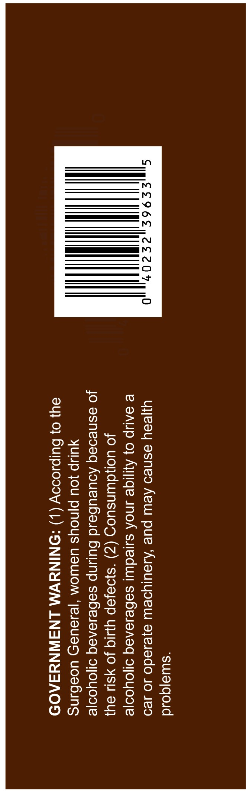
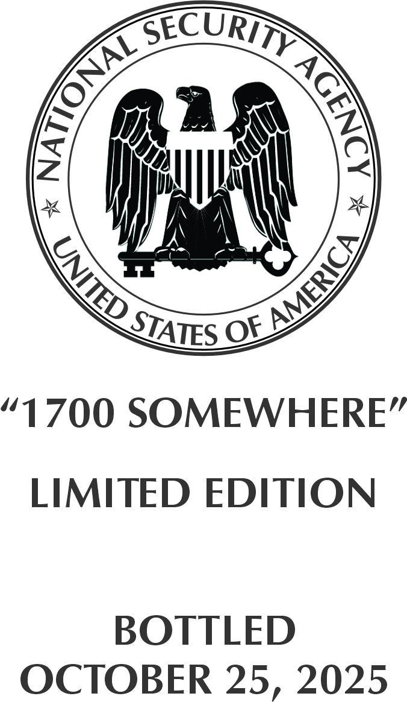

# TTB COLA Label Images - TTBID 26284001000065

**Brand Name:** TOBACCO BARN DISTILLERY

**Issue Date:** 10/20/2026

**Origin Code:** 25

**Product Class/Type:** 141

**Source:** [TTB Public COLA Registry](https://ttbonline.gov/colasonline/viewColaDetails.do?action=publicFormDisplay&ttbid=26284001000065)

## Label Images

### Front Label

### Label 2

### Label 3

### Label 4

## Extracted Label Text

*Text extracted via OCR - may contain errors*

*1 image(s) excluded: text did not meet readability threshold*

**Detected Proof:** 96

### Front Label

TOBACCO BARN
DISTILLERYS
BOURBON WHISKEY
DOUBLE BARRELED
DISTILLED IN MARYLAND
MATURED IN A No. 3 CHARRED BARREL
AND FINISHED IN A CUSTOM HEAVY TOAST
No. 1 CHARRED BARREL
48% ALC. BY VOL. (96 PROOF
750 ML

### Label 2

NVIQ ‘UITILSIG S100Z-CN-dS
SHTLLOG $47 J° $21 AILLOG CIN GOOMATIOY

SAV 9] SHINOW 7 SUVA § “HOY AVATILSIG NUVG ODEO]
10°SZ-[-[L ‘AIaNAN Tag Ad GATLLOG ANY GATTILSIG

### Label 3

“Suua|qoid

uyjeay asneo Aew pue ‘Ayaulyoew 9}eJ9d0 Jo we9
e SAWP 0} Ayiqe INOA suleduu! sebesensq o1oyooje
JO uoduunsuog (Z) “s}o9jap YLIG JO ¥SHJ Oy}

Jo asneseq Aoueubesd Bunp sebeseneq o1oyooje
YULP JOU pjnous USWOM ‘|e1aUas UOC@HiNS

94} 0} Bulpsoooy (|) “ONINYWM LNAWNYSA09
