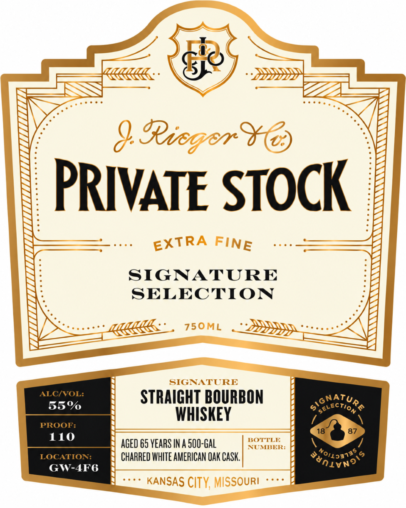

# TTB COLA Label Images - TTBID 26284001000068

**Brand Name:** J. RIEGER & CO. PRIVATE STOCK

**Issue Date:** 10/21/2026

**Origin Code:** 29

**Product Class/Type:** 101

**Source:** [TTB Public COLA Registry](https://ttbonline.gov/colasonline/viewColaDetails.do?action=publicFormDisplay&ttbid=26284001000068)

## Label Images

### Label 1

### Label 2

### Label 3

## Extracted Label Text

*Text extracted via OCR - may contain errors*

*1 image(s) excluded: text did not meet readability threshold*

**Detected Proof:** 110

### Label 1

ERirger
PRIVATE STOCK
SIGNATURE
SELECTION
750ML
SIGNATURE
ALCIVOL:
STRAIGHT BOURBON
55%
S hctura
WHISKEY
PROON:
18
87
110
BOTTLE
AGED 65 VEARS IN A 500-Gal
NUMBER:
LOCATION:
CHARRED WHITE AMERICAN OAK CaSk
489133g $
GW-4F6
KANSAS CITY, MISSOURI
EXTRA
FINE

### Label 2

Ricger
In /918, as Prohibition loomed, J. Rieger & Co. held a vast stock of
whiskey that soon  would be illegal to sell.  Jacob Rieger's   son,
Alexander; appealed for the legal right to transport every bottle to his
private  residence. In /920, Federal  Judge Faris issued an order
allowing Alexander to take home his "Private Stock". Today; we honor
this defiant effort by only releasing our most bold, innovative, and
deeply intentional bottlings under the coveted Private Stock name
NAThan PERRY
RVAN MAYBEE
MASTER DISTILLER
Co-FOUNDER
750ML
DISTILLED & BOTTLED BY
JACOB RIEGER & COMPANY, LLc
KANSAS CITY MISSOURI
GOVERHHENT WARHING:
ACCORDING TO THE  SURGEON
DSP-HIO 20U16
GENERAL, WOMEN SHOULD NOT DRINK ALCOHOLIC BEVERAGES
REFUHD Ia 45
DURING   PREGNANCY   BECAUSE   OF   ThE   RISK   OF   BIRTH
DEFECTS.
2)  CONSUMPTION   OF   ALCOHOLIC   BEVERAGES
VTME 05
IMPAIRS   YOUR   ABILITY   TO   DRIVE
CAR OR   OPERATE
MACHINERY; AND MAY CAUSE HeaLTh PROBLEMS.
Ca CRV
87790
96112
3
