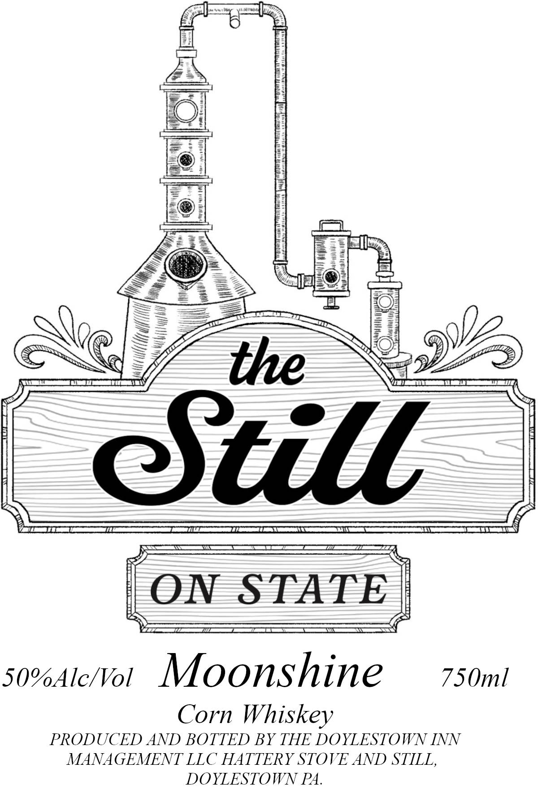
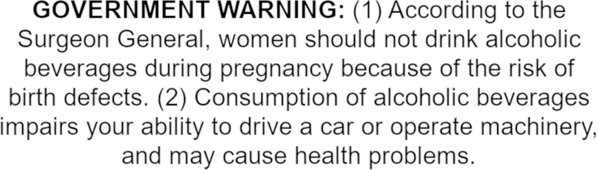

# TTB COLA Label Images - TTBID 26284001000070

**Brand Name:** THE STILL ON STATE

**Fanciful Name:** MOONSHINE

**Issue Date:** 10/16/2026

**Origin Code:** 39

**Product Class/Type:** 143

**Source:** [TTB Public COLA Registry](https://ttbonline.gov/colasonline/viewColaDetails.do?action=publicFormDisplay&ttbid=26284001000070)

## Label Images

### Label 1

### Label 2

## Extracted Label Text

*Text extracted via OCR - may contain errors*

**Detected Proof:** 100

### Label 1

the
@Still
ON
STATE
50%Alc/Vol
Moonshine
750ml
Corn Whiskey
PRODUCED AND BOTTED BY THE DOYLESTOWN INN
MANAGEMENT LLC HATTERY STOVE AND STILL,
DOYLESTOWN PA.

### Label 2

GOVERNMENT WARNING: (1) According to the

Surgeon General, women should not drink alcoholic

beverages during pregnancy because of the risk of

birth defects. (2) Consumption of alcoholic beverages

impairs your ability to drive a car or operate machinery

and may cause health problems.
