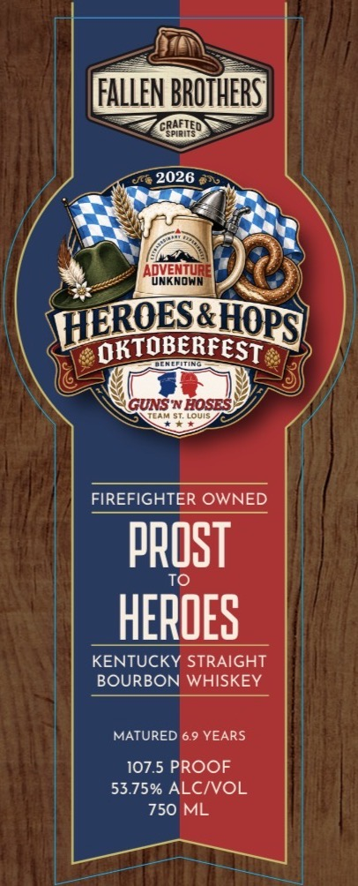
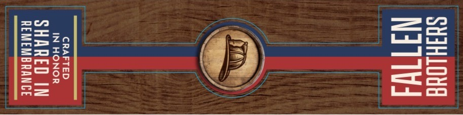
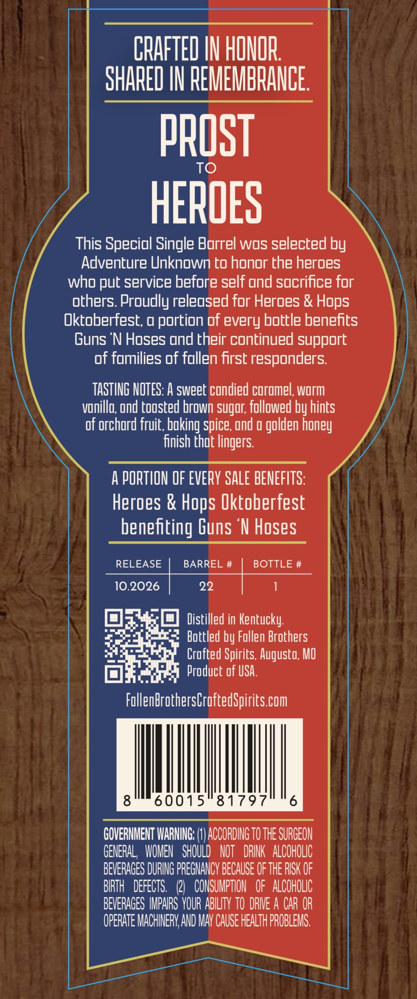

# TTB COLA Label Images - TTBID 26284001000110

**Brand Name:** FALLEN BROTHERS CRAFTED SPIRITS

**Fanciful Name:** PROST TO HEROES
KENTUCKY STRAIGHT BOURBON WHISKEY

**Issue Date:** 10/26/2026

**Origin Code:** 29

**Product Class/Type:** 101

**Source:** [TTB Public COLA Registry](https://ttbonline.gov/colasonline/viewColaDetails.do?action=publicFormDisplay&ttbid=26284001000110)

## Label Images

### Label 1

### Label 2

### Label 3

## Extracted Label Text

*Text extracted via OCR - may contain errors*

**Detected Proof:** 107.5
**Detected Age:** 6.9 Years

### Label 1

FALLEN BROTHERST
CRAFTED
2026
Aonarowr
LROESQHOPSC
OKTOBERFEST
GUNS N HOSES
Louis
FIREFIGHTER OWNED
pROST
TO
HEROES
KENTUCKY STRAIGHT
BOURBON WHISKEY
MATURED 6.9 YEARS
107.5 PROOF
53.75% ALCIVOL
750 ML

### Label 2

SUIHLOUE

CRAFTED |
IN HONOR

SHARED IN
REMEMBRANCE

### Label 3

CRAFTED IH HONOR
SHARED I| REMEMBRANCE
PROST
To
HEROES
This Specidl Single Barrel wos selected by
Adventure Unknown to honor the heroes
who put service before self ond socrifice for
others Proudly releosed for Heroes &
Oktoberfest; u portion of every bottle benefits
Guns 'N Hoses ond their continued support
of fomilies of follen first responders:
TASTING NOTES: A sweet cundied coromel, worm
vonillo; ond toosted brown sugor; followed by hints
of orchord fruit; boking spice und _
finish that lingers
A PORTION OF EVERY SALE BENEFITS:
Heroes &
s Oktoberfest
benefiting Guns 'N Hoses
RELEASE
BARREL #
BOTTLE #
10.2026
22
Distilled in Kentucky:
Boteled by Fullen Brothers
Crofted Spirits, Augusto, MO
Product of uSA:
FullenBrothersLroftedSpirits com
8
60015
81797
6
GOVERHMENT IARMING: (#J ACCORDING TO THE SURGEON
GENERAL , WOMEN   ShouLd   NOT   DRINK   ALCOHOLIC
BEVERAGES DURING PREGNANCY BECAUSE OF THE RISK OF
BIRTH   DefEcts.  (21  CONSUMPTHON
OF   ALCOHOLIC
BEVERAGES IPAIRS YOUR ABILITY TO DRIE A CAR OR
OPERATE MACHINERV AND MAV CAUSE HEALTH PROBLEMS.
Hops
golden
honey
Hops
