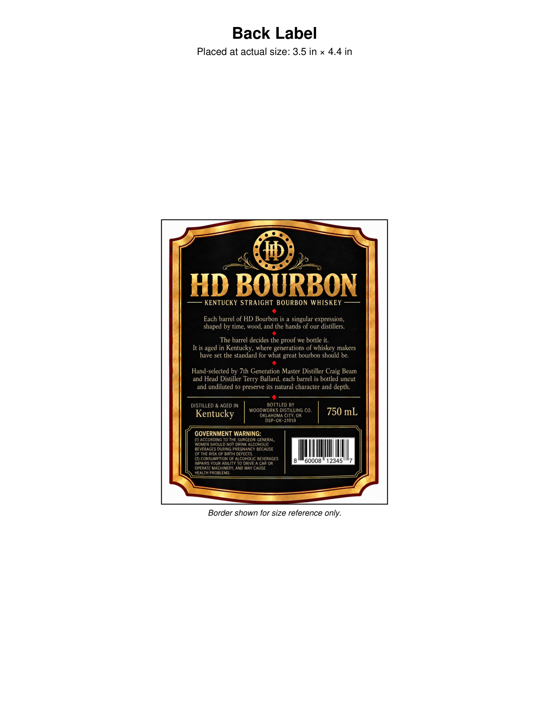
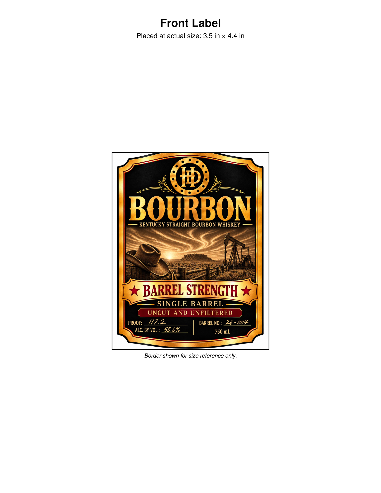

# TTB COLA Label Images - TTBID 26285001000116

**Brand Name:** HD

**Fanciful Name:** BARREL STRENGTH BOURBON

**Issue Date:** 10/27/2026

**Origin Code:** 22

**Product Class/Type:** 101

**Source:** [TTB Public COLA Registry](https://ttbonline.gov/colasonline/viewColaDetails.do?action=publicFormDisplay&ttbid=26285001000116)

## Label Images

### Back Label

### Front Label

## Extracted Label Text

*Text extracted via OCR - may contain errors*

**Detected Proof:** 117.2

### Back Label

Back Label
Placed at actual size: 3.5 in x 4.4 in
HD BOURBON
KENTUCKY STRAIGHT BOURBON WHISKEY
Each barrel of HD Bourbon is a singular expression,
shaped by time; wood, and the hands of our distillers_
The barrel decides the proof we bottle it.
It is
in Kentucky,
where
generations of whiskey makers
have set the standard for what great bourbon should be:
Hand-selected by Zth Generation Master Distiller Craig Beam
and Head Distiller Terry Ballard, each barrel is bottled uncut
and undiluted to preserve its natural character and depth.
DISTILLED & AGED IN
BOTTLED BY
WOODWORKS DISTILLING CO.
750 mL
Kentucky
OKLAHOMA City, Ok
DSP-OK-21019
GOVERNMENT WARNING:
(1) ACCORDING TO THE SURGEON GENERAL,
WOMEN SHOULD NOT DRINK ALCOHOLIC
BEVERAGES DURING PREGNANCY BECAUSE
OF THE RISK OF BIRTH DEFECTS
(2) CONSUMPTION OF ALCOHOLIC BEVERAGES
60008
12345
IMPAIRS YOUR ABILITY TO DRIVE
CAR OR
OPERATE MACHINERY; AND MAY CAUSE
HEALTH PROBLEMS.
Border shown for size reference only:
aged

### Front Label

Front Label
Placed at actual size: 3.5 in x 4.4 in
BOURBON
KENTUCKY STRAIGHT BOURBON WHISKEY
BARREL STRENGTH
SINGLE
BARREL
UNCUT
AND UNFILTERED
PROOF:
1l7.2
BARREL NO:
004
ALC. BY VOL:
58.6%
750 mL
Border shown for size reference only:
26_-
