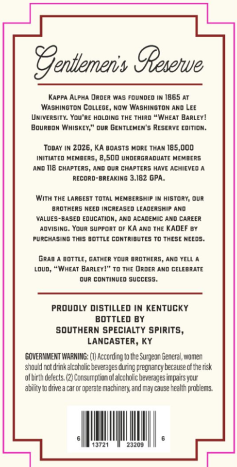
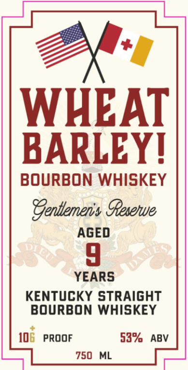

# TTB COLA Label Images - TTBID 26285001000135

**Brand Name:** GENTLEMAN'S RESERVE

**Issue Date:** 10/16/2026

**Origin Code:** 22

**Product Class/Type:** 101

**Source:** [TTB Public COLA Registry](https://ttbonline.gov/colasonline/viewColaDetails.do?action=publicFormDisplay&ttbid=26285001000135)

## Label Images

### Back Label

### Front Label

## Extracted Label Text

*Text extracted via OCR - may contain errors*

**Detected Proof:** 106
**Detected Age:** 4 Years

### Back Label

Sentlemenis Geserwue
Kappa ALPHA dader Was founded IW 1865 AT
Washington ColLege, Now Washingtom And LEe
University: Yov'Re holding The third
'WHEAT BARLEY !
Bourbon Whiskey;" our gcntlcmen'5 Rescrve cdition:
TodaY Im 2026, KA Boasts Hore THAN 185,000
Initiateo MeMbers
500 undergraduate Mehbers
And 118 chapteRs , And our chapters Have Achieved .
Record-BreAKING 3.182 GPA:
With ThE Largest ToTAL Hembership
histort, ovr
brotheRS Necd increased Lcadership ANd
VALuES-baseo education; And
cadehic And CAREER
advising: Your support df KA And The KAdEF BY
purchasing This bottle comtributes To These Needs.
Grab
bottle, Gather Your brothers, ANd YelL
Lovd,
Wheat BARLEY!" To The Order Ano CeLebRATE
dur continued succcss
PRoudly distilled IN KEnTUCKY
BOTTLED BY
southern SPECIALTY spirits,
LANCASTER, Ky
GOVERNMEMT WAANING: (1) According to Uhe Surgean Genera , women
should nctdrinkalcoholic beverages during pregnancy because of the risk
olb rth delects (2) Consumption 0l alcuhol c beveragesin pairs your
abinty to dnve a car Of @perate Mach nery and may cause health probems
23209

### Front Label

WHEAT
BARLEYL
BOURBON WHISKEY
Sentemens Gesene
AGED
4
YEARS
KENTUCKY STRAIGHT
BOURBON WHISKEY
106
PROOF
53%
ABV
750
ML
