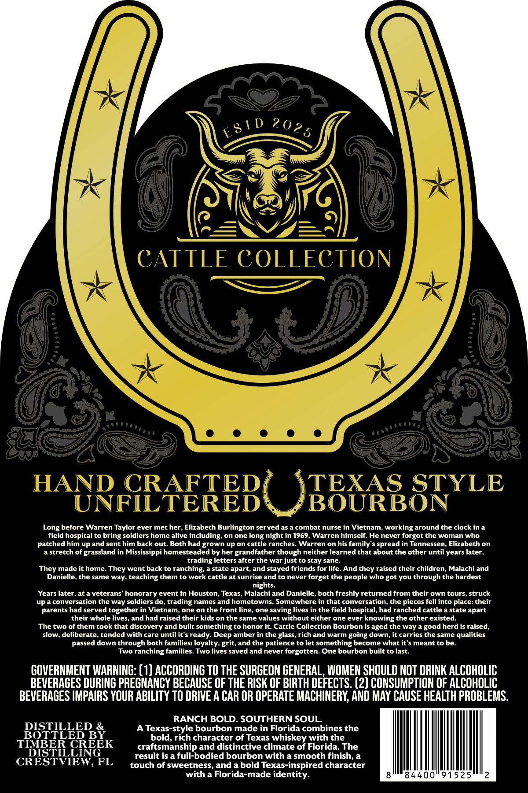
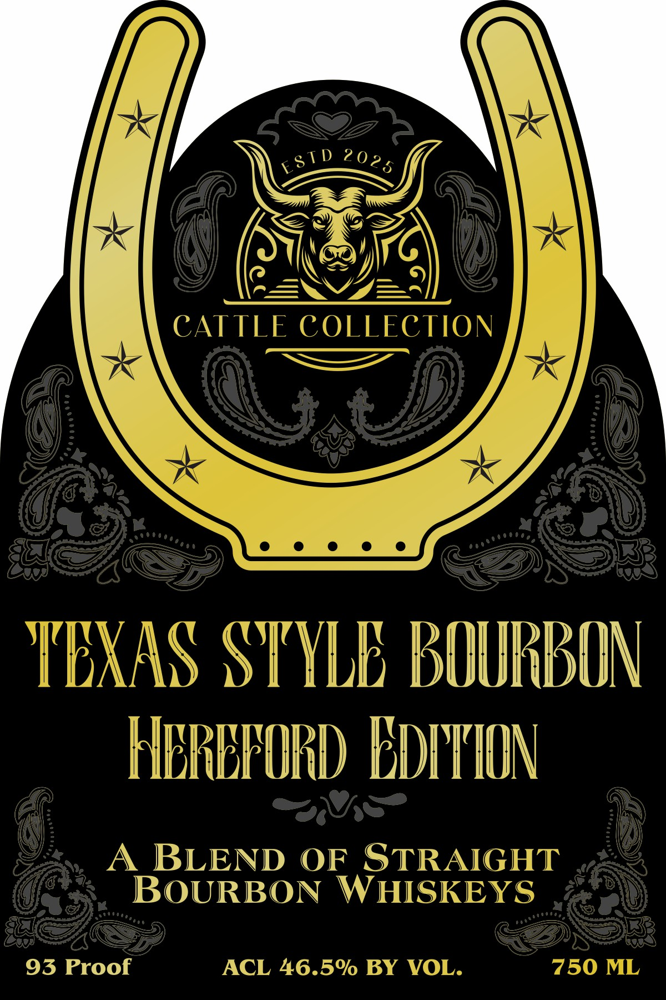

# TTB COLA Label Images - TTBID 26285001000174

**Brand Name:** CATTLE COLLECTION

**Fanciful Name:** TEXAS STYLE BOURBON, HEREFORD EDITION

**Issue Date:** 10/23/2026

**Origin Code:** 16

**Product Class/Type:** 121

**Source:** [TTB Public COLA Registry](https://ttbonline.gov/colasonline/viewColaDetails.do?action=publicFormDisplay&ttbid=26285001000174)

## Label Images

### Back Label

### Front Label

## Extracted Label Text

*Text extracted via OCR - may contain errors*

**Detected Proof:** 93

### Back Label

CATTLE COLLECTION
HAND CRAFTED
OBBURSSTYLE
UNFILTERED
BOURBON
~Long before Warren Taylor ever met her, Elizabeth Burlington served as a combat nurse in Vietnam, working around the clock in a
field hospital to bring soldiers home alive including:
on one
long night in 1969
Warren himself. He never forgot the woman who
patched him up and sent him back out. Both had grown up on cattle ranches.
Warren on his family'
spread in Tennessee, Elizabeth on
a stretch of grassland in Mississippi homesteaded by her grandfather though neither learned that about the other until years later,
trading letters after the war just to stay sane_
made it home_
went
back to ranching; a state apart, and stayed friends for life. And they raised their children, Malachi and
Danielle, the same way, teaching them to work cattle at sunrise and to never forget the people who
you through the hardest
nights.
Years later, at a veterans' honorary event in Houston, Texas, Malachi and Danielle, both freshly returned from their own tours, struck
uP
conversation the way soldiers do_
trading
names and hometowns. Somewhere in that conversation; the pieces fell into place: their
parents had served together in Vietnam
one on the front line
one
saving lives in the field hospital, had ranched cattle a state apart
their whole lives, and had raised their kids on the same values without either one ever knowing the other existed:
The two of them took that discovery and built something to honor it  Cattle Collection Bourbon is aged the way a good herd is raised,
slow, deliberate, tended with care until it'$ ready: Deep amber in the glass, rich and warm going down; it carries the same qualities
passed down through both families: loyalty; grit, and the patience to let something become what it $ meant to be
Two ranching families
Two lives saved and never forgotten: One bourbon built to last.
GOVERNMENT WARNING: (1) ACCORDING TO THE SURGEON GENERAL, WOMEN SHOULD NOT DRINK ALCOHOLIC
BEVERAGES DURING PRECNANCY BECAUSE OF THE RISK OF BIRTH DEFECTS. (2) CONSUMPTION OF ALCOHOLIC
BEVERACES IMPAIRS YOUR ABILITY TO DRIVE A CAR OR OPERATE MACHINERY,; AND MAY CAUSE HEALTH PROBLEMS:
RANCH BOLD. SOUTHERN SOUL.
DISTILLED &
A Texas-style bourbon made in Florida combines the
BOTTLED BY
bold, rich character of Texas whiskey with the
TIMBER CREEK
craftsmanship and distinctive climate of Florida: The
DISTILLING
result is a full-bodied bourbon with a smooth finish, a
CRESTVIEW, FL
touch of sweetness, and a bold Texas-inspired character
with a Florida-made identity:
84400"91525
2 0 2 5
ES T D
They
They
got

### Front Label

CATTLE COLLECTION
YEXAS SYYLE BOuRBON
HEREFORD EDIHON
BLEND
OF
STRAIGHT
BOURBON
WHISKEYS
93 Proof
ACL 46.5% BY VOL:
750 ML
2 0 2 5
ES T D
