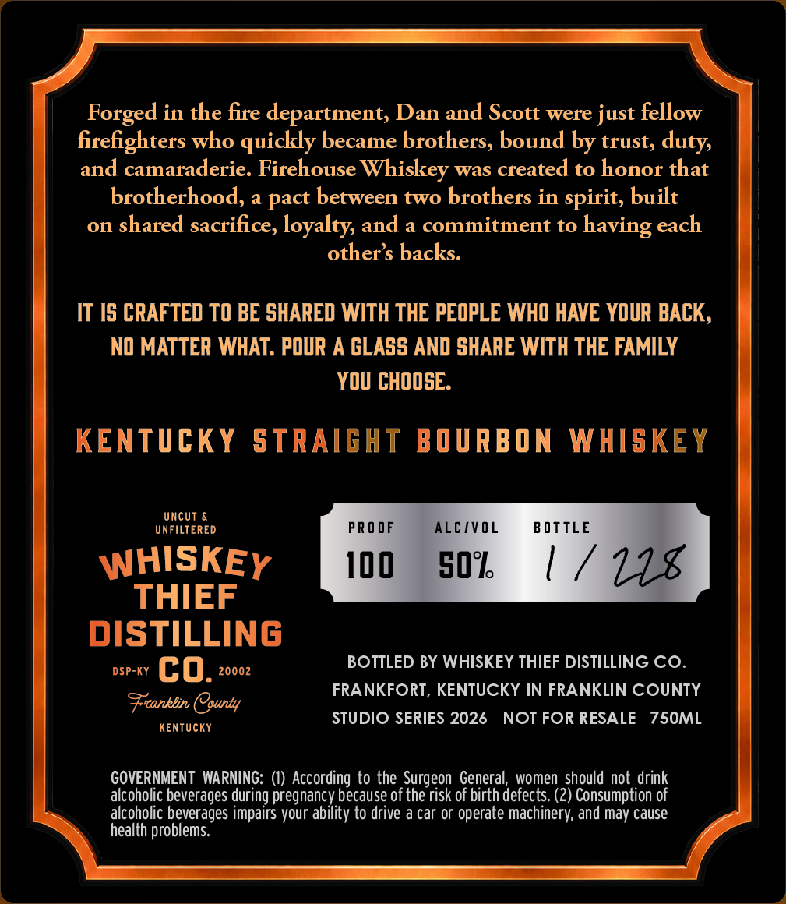
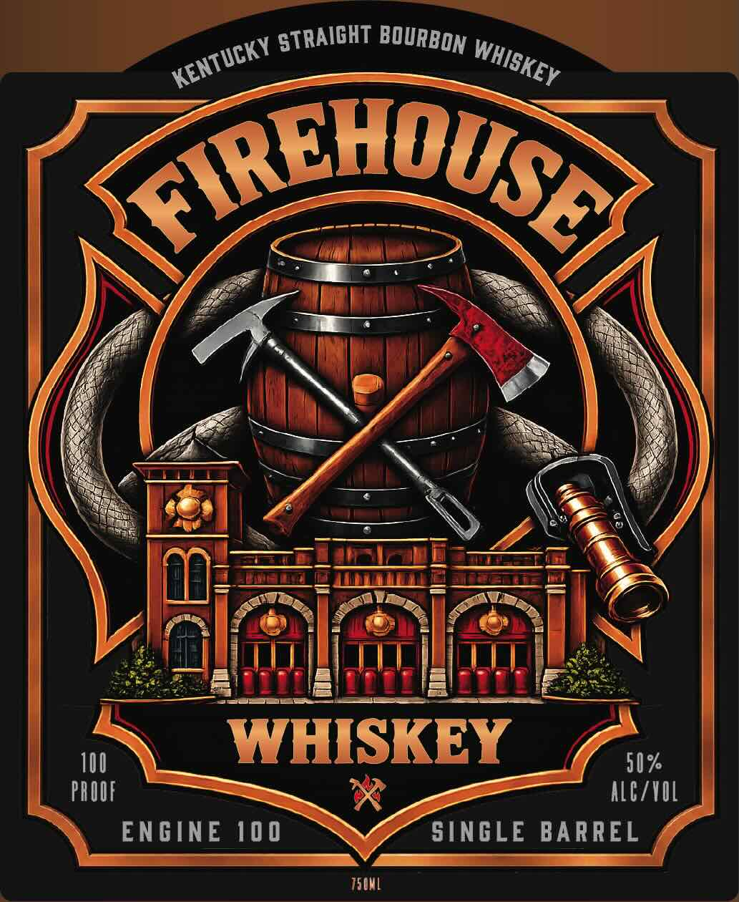

# TTB COLA Label Images - TTBID 26285001000272

**Brand Name:** WHISKEY THIEF DISTILLING CO.

**Issue Date:** 10/19/2026

**Origin Code:** 22

**Product Class/Type:** 101

**Source:** [TTB Public COLA Registry](https://ttbonline.gov/colasonline/viewColaDetails.do?action=publicFormDisplay&ttbid=26285001000272)

## Label Images

### Back Label

### Front Label

## Extracted Label Text

*Text extracted via OCR - may contain errors*

**Detected Proof:** 100

### Back Label

Forged in the fire department, Dan and Scott were just fellow
firefighters who quickly became brothers, bound by trust, duty,
and camaraderie. Firehouse Whiskey was created to honor that

brotherhood, a pact between two brothers in spirit, built
on shared sacrifice, loyalty, and a commitment to having each
other’s backs.

IT IS CRAFTED TO BE SHARED WITH THE PEOPLE WHO HAVE YOUR BACK,
NO MATTER WHAT. POUR A GLASS AND SHARE WITH THE FAMILY
YOU CHOOSE.

KENTUCKY STRAIGHT BOURBON WHISKEY

UNCUT &
UNFILTERED PROOF ALCIVOL BOTTLE

inttLés ame 100 SOL, | /
THIEF 18
DISTILLING

DSP-KY Cc 0. rere BOTTLED BY WHISKEY THIEF DISTILLING CO.
. FRANKFORT, KENTUCKY IN FRANKLIN COUNTY
Freanklin (purty
KENTUCKY STUDIO SERIES 2026 NOTFORRESALE 750ML

GOVERNMENT WARNING: (1) According to the Surgeon General, women should not drink
alcoholic beverages during pregnancy because of the risk of birth defects. (2) Consumption of
alcoholic beverages impairs your ability to drive a car or operate machinery, and may cause
health problems.

### Front Label

ZthuuseA
10U
WHISKEY
50%
pRUIF
ALCITIL
ENGINE 100
SINGLE BARREL
TSML
STRAIGHT
BOURBON
KENTUCKY
WHISKEY
