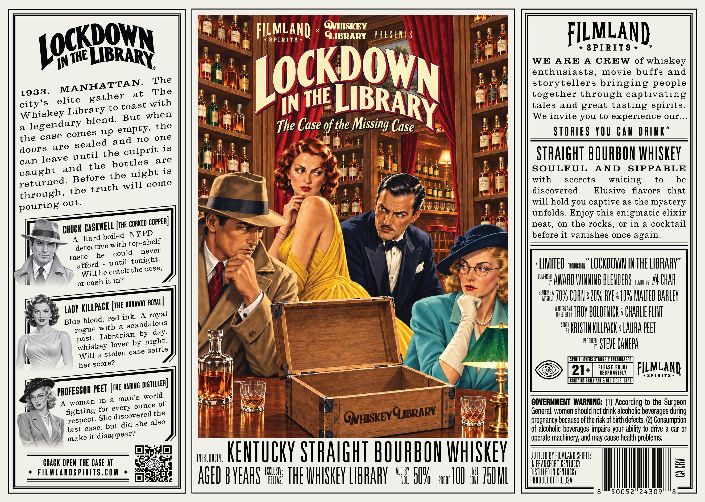
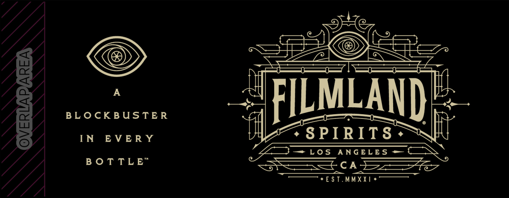

# TTB COLA Label Images - TTBID 26285001000276

**Brand Name:** FILMLAND SPIRITS

**Fanciful Name:** LOCKDOWN IN THE LIBRARY

**Issue Date:** 10/16/2026

**Origin Code:** 22

**Product Class/Type:** 101

**Source:** [TTB Public COLA Registry](https://ttbonline.gov/colasonline/viewColaDetails.do?action=publicFormDisplay&ttbid=26285001000276)

## Label Images

### Label 1

### Label 2

### Label 3

## Extracted Label Text

*Text extracted via OCR - may contain errors*

*2 image(s) excluded: text did not meet readability threshold*

### Label 1

GNHISKEY
FILMLAND
8 PIRIT8
GIBRARY
PRESElTS
FILMLAN)
8 PIRITS
IN
MBRARY
WE
ARE
A
CREW of whiskey
The
LOcKDown
enthusiasts_
movie buffs and
MANHATTAN:
storytellers bringing people
1933.
at
The
together through captivating
city' s
elite
to
toast
IN
tales and great tasting spirits.
Whiskey Library
But when
We invite you to
experience our
a
legendary
up
empty, the
The Case of the Missing Case
STORIES YOU Can DRIAKE
the case comes
no
one
doors
the
is
STHAIGHT BOURBON whSkeY
can leave
bottles
are
is
SOULFUL
AND
SIPPABLE
retughed  Beforethenigkoze
with
secrets
waiting
to
be
the
will
discovered.
Elusive
flavors
that
through,
will hold you captive a8 the mystery
unfolds. Enjoy this enigmatic elixir
GASKYELL [the GORKED Copper] |
neat, on the rocks,
or in a cocktail
BHUCK BaGd-toiledt NYPPa
before it vanishes once
A_
detective
taste
he
until tonight:
LITED ,uwuer "LOCKDOWU INTHE LIBHARV"
Will he crack the case,
CUMPOSFD
or
it in?
AWARI WUIHG BLEHIERS
FEATURING
#4 ChAR
STHHYR
7I6 CURle2U FVEbIIV MALTED PAHLEV
Lady KILLpack [thE RuHaYay Ryal]
WHITTEHAHI
ink:
A
DHRECTEI BY
THOY BULOTHICK: CHARLIE FLINT
Blue blood,
scandalous
STORK
rogue with &
day,
KRISTHU KILLPACK : Lauha PEET
Librarian
by
@hiskeyhlover by nigtle
HX
STEVE CANEPA
Wilike stolen case settle
CPHHLL LOVERS STROLGLY ENCOUHNGED
her
21+
PLEASE EMJOY
FILMLAND
RESPOMSIBLY
8PIRIT8
CONTAINS BRILLIART & DELICHOUS MDEAS
pbofessor pEet [tE DAblg pisthuaa]
A
in
a
of
GOVERNMENT WARNING: (1) According to the Surgeon
fighting for evero orecehe
General; women should not drink alcoholic beverages during
fespecg She diszdvehed tse
pregnancy because of the risk of birth defects. (2) Consumption
last case, but did
of alcoholic beverages impairs your ability to drive a car Or
make it disappear?
operate machinery; and may cause health problems.
IHTRIIUUHG
KEUTUCKY STRAIGHT BOURPOH WHHSKEY
BUTTLEI BY FLLMLAHD SPRITS
CRACK OPEM THE CASE AT
IU FRANKFURT, KENTUCKY
3
FILMLAADSPIRITS.COM
AGEI 8 VEARS FF THE WHSHEV LIPHARV
HLH
BU
PRUUF
IUI # Z5U1L
HHUTHF OFHeUrat
3
8
50052
24309
8
LOGKPQwN
THE
LIBRARY
THE
gather
with
blend.
and
sealed
are
culprit
until
the
and
caught
truth
out.
pouring
again.
top-shelf
with
never
could
afford
cash
royal
red
score?
world,
man'S
woman
QNHISKEYOLIBRARY
