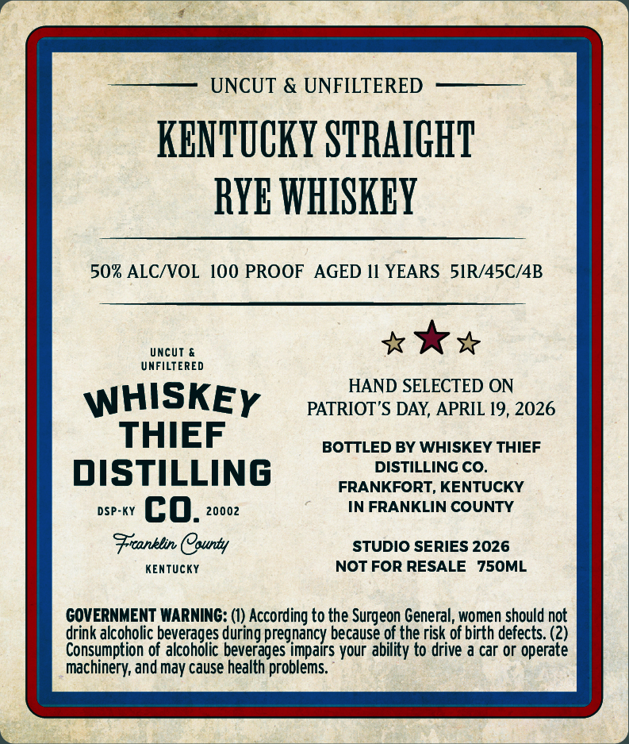
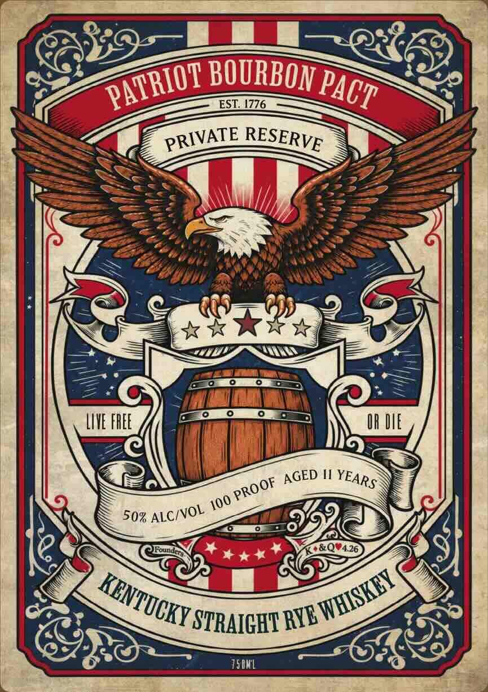

# TTB COLA Label Images - TTBID 26285001000291

**Brand Name:** WHISKEY THIEF DISTILLING CO.

**Issue Date:** 11/03/2026

**Origin Code:** 22

**Product Class/Type:** 101

**Source:** [TTB Public COLA Registry](https://ttbonline.gov/colasonline/viewColaDetails.do?action=publicFormDisplay&ttbid=26285001000291)

## Label Images

### Back Label

### Front Label

## Extracted Label Text

*Text extracted via OCR - may contain errors*

**Detected Proof:** 100

### Back Label

UNCUT & UNFILTERED
KENTuCKY SSTRAIGHT
RYE WHISKBY
50% ALCIVOL
100 PROOF AGED II YEARS  SIR/4SC/4B
Uncut &
UNFILTERED
HAND SELECTED ON
WHISKEY
PATRIOT'S DAY, APRIL 19,2026
THIEF
BOTTLED BY WHISKEY THIEF
DISTILLING
DISTILLING CO_
FRANKFORT, KENTUCKY
DSP-KY
co.
20002
IN FRANKLIN COUNTY
Franblin County
STUDIO SERIES 2026
KEnTUcKY
NOT FOR RESALE
750ML
COVERNMENT WARNING: (1) According to the Surgeon General, women should not
drink alcoholic beverages during pregnancy because of the risk of birth defects. (2)
Consumption of alcoholic beverages impairs your ability to drive a car or operate
machinery, and may cause health problems.

### Front Label

BOURBON
ESL 4776
LIVE FHEE
OR
M
'STRAIGHT =
I5IHL
PATRIOT
PACT
PRIVATE
RESERVE
AGED
YEARS
PROOF
100
ALC/VOL
50%
WHISKEY =
KENTUCKY $
RYE
