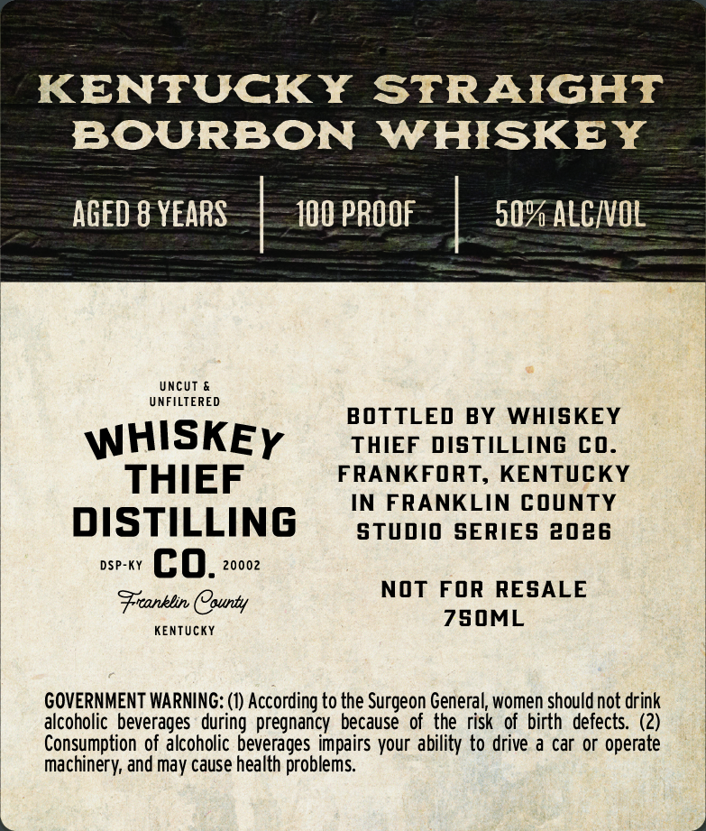
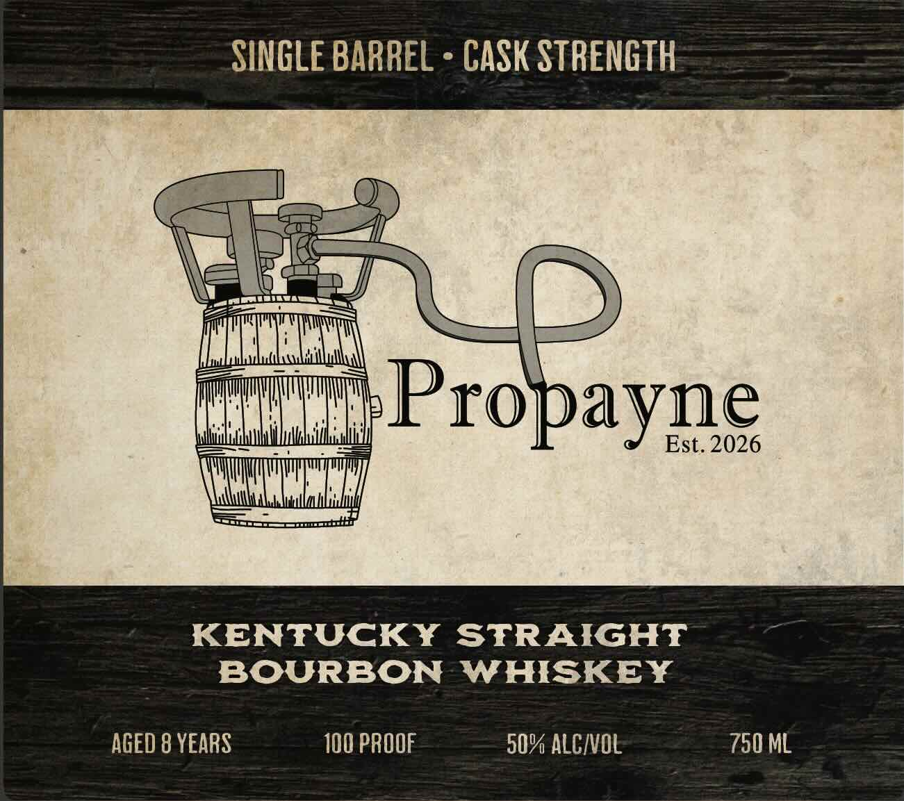

# TTB COLA Label Images - TTBID 26285001000299

**Brand Name:** WHISKEY THIEF DISTILLING CO.

**Issue Date:** 10/19/2026

**Origin Code:** 22

**Product Class/Type:** 101

**Source:** [TTB Public COLA Registry](https://ttbonline.gov/colasonline/viewColaDetails.do?action=publicFormDisplay&ttbid=26285001000299)

## Label Images

### Back Label

### Front Label

## Extracted Label Text

*Text extracted via OCR - may contain errors*

**Detected Proof:** 100
**Detected Age:** 8 Years

### Back Label

KENTUCKY STRAIGHT
BOURBON WHISKEY

AGED 8 YEARS | 100 PROOF | 50% ALCVOL

UNFILTERED

BOTTLED BY WHISKEY
WHISKEy = tater oisticuine co.
THIEF FRANKFORT, KENTUCKY

IN FRANKLIN COUNTY

DISTILLING = stun series anas
DSP-KY Co. 20002

Franklin County

KENTUCKY

NOT FOR RESALE
7S50ML

GOVERNMENT WARNING: (1) According to the Surgeon General, women should not drink
alcoholic beverages during pregnancy because of the risk of birth defects. (2)
Consumption of alcoholic beverages impairs your ability to drive a car or operate
machinery, and may cause health problems.

### Front Label

SINGLE BARREL
CASK STRENGTH
Y
Propayne
Est. 2026
KENTUCKY
STRAIGHT
BOURBON
WHISKEY
AGED 8 YEARS
100 PROOF
50% ALCIVOL
750 ML
