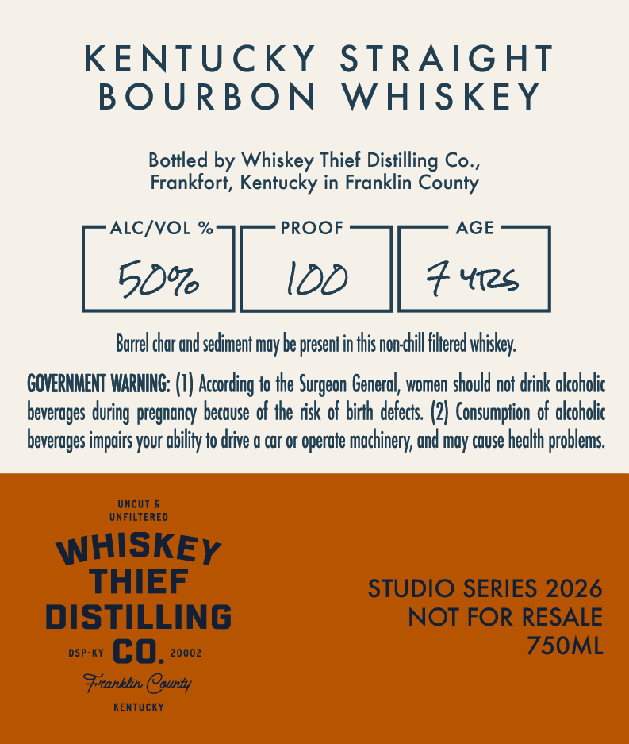
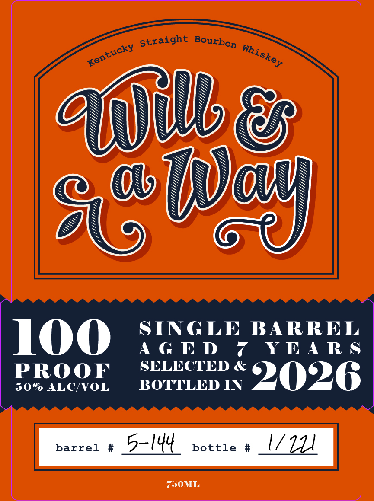

# TTB COLA Label Images - TTBID 26285001000303

**Brand Name:** WHISKEY THIEF DISTILLING CO.

**Fanciful Name:** WILL AND A WAY KENTUCKY STRAIGHT BOURBON WHISKEY

**Issue Date:** 10/20/2026

**Origin Code:** 22

**Product Class/Type:** 101

**Source:** [TTB Public COLA Registry](https://ttbonline.gov/colasonline/viewColaDetails.do?action=publicFormDisplay&ttbid=26285001000303)

## Label Images

### Back Label

### Front Label

## Extracted Label Text

*Text extracted via OCR - may contain errors*

**Detected Proof:** 100
**Detected Age:** 7 Years

### Back Label

KENTUCKY
STRAIGHT
BO URBON
WHISKEY
Bottled by Whiskey Thief Distilling Co _
Frankfort, Kentucky in Franklin County
ALC/VOL %
PROOF
AGE
50%6
IDD
Yi2s
Burrel char ond sediment moy be present in this non-chill filered whiskey:
COVERNMENT WARNING: (V) According to the
Generol, women should not drink alcoholic
beverages
pregnoncy becouse of the risk of birh derects. (2) Consumption of olcoholic
beveroges impoirs your obility to drive @ cor or operate machinery; ond may couse heolh _
! problems
UncUt
UNFILTERED
WHISKEY
THIEF
STUDIO SERIES 2026
DISTILLING
NOT FOR RESALE
DSP-KY
co.
20002
75OML
Franklin COounty
KentUcKY
Surgeon ,
during =

### Front Label

SIS
NUN
100 SINGLE BARREL
AGED 7 YEARS
PRO OF SELECTED & 9026
50% ALC/VOL BOTTLED IN
barrel # 5- (44 bottle # (7/7
750ML
