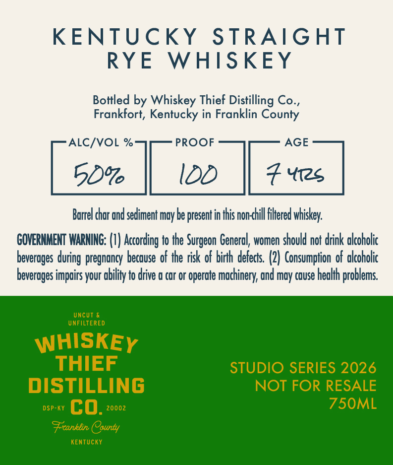
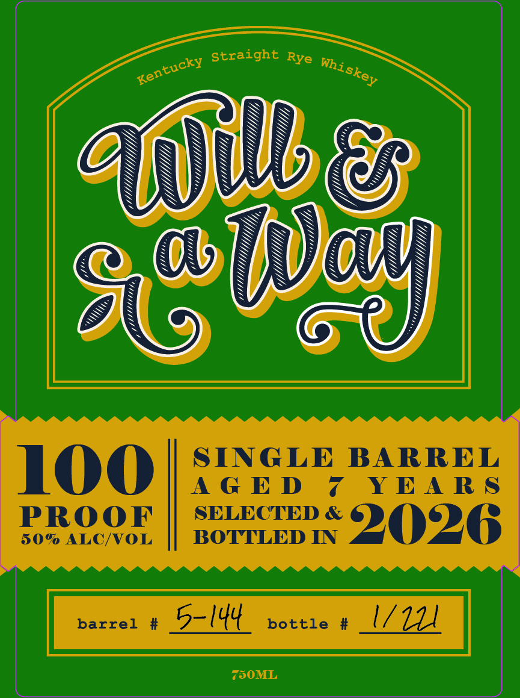

# TTB COLA Label Images - TTBID 26285001000305

**Brand Name:** WHISKEY THIEF DISTILLING CO.

**Issue Date:** 10/19/2026

**Origin Code:** 22

**Product Class/Type:** 102

**Source:** [TTB Public COLA Registry](https://ttbonline.gov/colasonline/viewColaDetails.do?action=publicFormDisplay&ttbid=26285001000305)

## Label Images

### Back Label

### Front Label

## Extracted Label Text

*Text extracted via OCR - may contain errors*

**Detected Age:** 7 Years

### Back Label

KENTUCKY
STRAIGHT
RYE
WHISKEY
Bottled by Whiskey Thief Distilling Co ,
Frankfort, Kentucky in Franklin County
ALC/VOL %
PROOF
AGE
50%6
IDD
Yi2s
Burrel chor and sediment moy be present in this non-chill fltered
GOVERNMENT WARNING: (V) According to #he
General, women should not drink akcoholic
beverages
pregnongy becouse of the risk of birh derects. (2) Consumption of okcoholic
beverages impairs your obilfy to drive @ cor or operate mochinery; gnd moy couse heokh
! problems
UncUT
UNFILTERED
WHISKEY
THIEF
STUDIO SERIES 2026
DISTILLING
NOT FOR RESALE
DSP-KY
cO:
20002
75OML
Frconklin County
KenTUcKY
whiskey:
Surgeon
during "

### Front Label

100 SINGLE BARREL
AGED ¢7 YEARS
FROOE || sorreen wm 2O2ZG

barrel # 5-144 bottle # l/l
