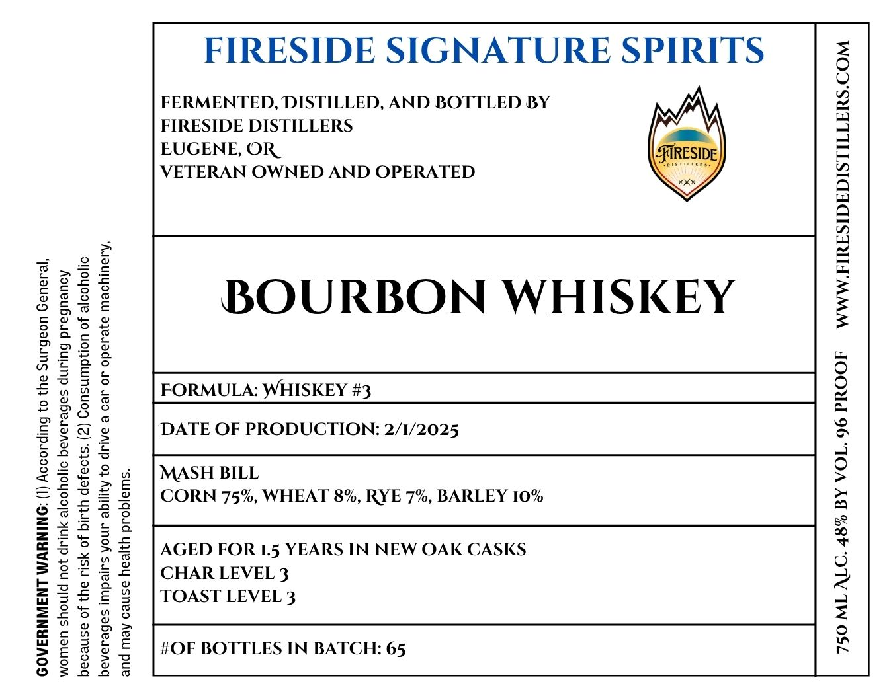

# TTB COLA Label Images - TTBID 26285001000307

**Brand Name:** FIRESIDE SIGNATURE SPIRITS

**Issue Date:** 10/23/2026

**Origin Code:** 38

**Product Class/Type:** 141

**Source:** [TTB Public COLA Registry](https://ttbonline.gov/colasonline/viewColaDetails.do?action=publicFormDisplay&ttbid=26285001000307)

## Label Images

### Label 1

## Extracted Label Text

*Text extracted via OCR - may contain errors*

### Label 1

GOVERNMENT WARNING: (1) According to the Surgeon General,

women should not drink alcoholic beverages during pregnancy

because of the risk of birth defects. (2) Consumption of alcoholic

beverages impairs your ability to drive a car or operate machinery,

and may cause health problems.

FIRESIDE SIGNATURE SPIRITS

FERMENTED, DISTILLED, AND BOTTLED BY
FIRESIDE DISTILLERS

EUGENE, OR_

VETERAN OWNED AND OPERATED

BOURBON WHISKEY

FORMULA: WHISKEY #3
DATE OF PRODUCTION: 2/1/2025

MASH BILL
CORN 75%, WHEAT 8%, RYE 7%, BARLEY 10%

AGED FOR 1.5 YEARS IN NEW OAK CASKS
CHAR LEVEL 3
TOAST LEVEL 3

#OF BOTTLES IN BATCH: 65

=
°
(e)
2
za)
=|
=
=
Z
Qa
g
a
7)
ma
=
axl
2
=
=
—
fe)
ie}
[4
a
No)
a
=|
°
>
>
fa
Re
C)
=
g
4
=)
=
io}
wn
~~
