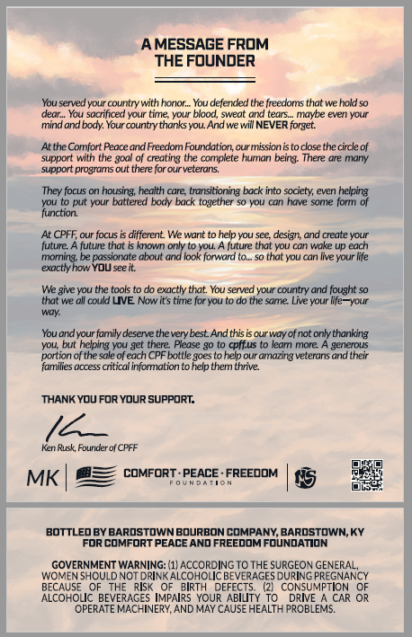
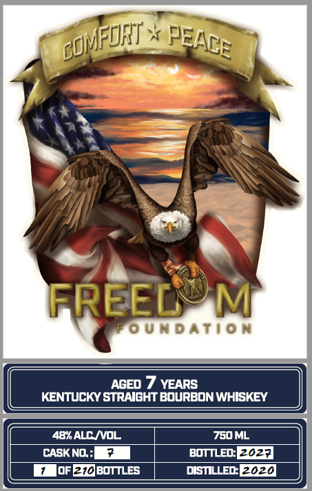

# TTB COLA Label Images - TTBID 26285001000404

**Brand Name:** FREEDOM FOUNDATION

**Issue Date:** 10/16/2026

**Origin Code:** 22

**Product Class/Type:** 101

**Source:** [TTB Public COLA Registry](https://ttbonline.gov/colasonline/viewColaDetails.do?action=publicFormDisplay&ttbid=26285001000404)

## Label Images

### Back Label

### Label 1

## Extracted Label Text

*Text extracted via OCR - may contain errors*

### Back Label

A MESSAGE FROM
THE FOUNDER
You served your counlry with
You deferded the freedorrs that wehold 5o
Veur
You socrliced your time your blood, sweat und tears;_
maybe even your
mind and body: Your country thanks yOu And we vvill NEVER forget:
Ar tne Comfort Peace and Freedom Foundation; cur missionis t0 close the circle of
support wilh (he gOI Of creating the coxpiete hurian beirg: Inere are miany
supbon
programs out there for our veterans_
They focus on nousing; health care; transitioning back into society; even neping
put your bxltered body bxck togetner
You can have
Lte
ron
furction:
At CPFF; our focus
diferent We want to help YOu sce design; and create your
future
future tnor _
knovn only to you; _
fulure that VOU can wake Up eacn
morlirg be passiorale aboul arid look forward t0= 50 that YOU cdn live your ffe
exactlyhon YOU seeit
We give =
the tols
do exactly that YOu served ypur country and fought 5o
that we all could LIVE Nowirs tirie for yu t0 do the sarrie: Live your Iife-vour
Wuk
You andyour family deserve the very best_ Andthis is our wayofnot only thanking
helping you get there Please g0 t0 cpffus to leam more
gererous
porlior of the sale of each CPF
bxllle goes to help our drriazing veterans drd their
families (ccess cnticai infomation to help them thrive:
THANK YOV FoRYOuR SUPPORT:
Ken Rusk Fourider ol CPFF
MK
comforT-PEACE - FREEDDM
bottledBY BARdsToWNBourboN COMPANY BARDSTOWN;KY
For comfort PEACE And FREEDOMFOUNDAMON
GOVERNMENT WARNING: (1/ ACCORDING T0 THE SURGEON GENERAL,
WOMEN SHOULDNOT DRINK ALCOHOLIC BEVERAGES DURING PREGNANCY
BECAUSE
THE
RIsk
BIRTH
DEFECTS
CONSUMPTION
ALCOHOLIc BEVERAGES IMPAIRS YOUR ABIL
DRIVE
CAR OR
OPERATE MACHINERY AND MAY CAUSE HEALTH PROBLEMS:
hon

### Label 1

FREED
M
F0 UnDATIO N
Aged
1 YEARS
KENTUCKY STRAIGHT BOurBON WHISKEY
48K ALC /voL
750ML
CASK NO :
bottLed:
Eoza
oFE1OBOTTLES
DISTILLED2020
COFIRT
PEACE
