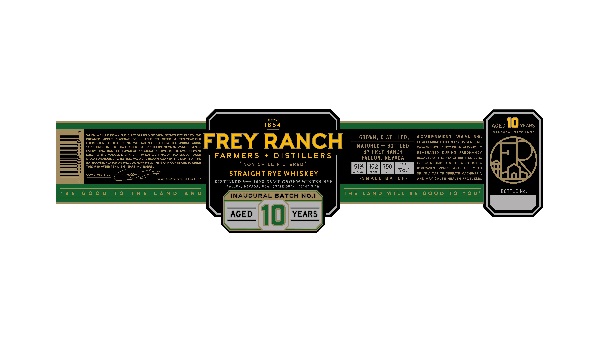

# TTB COLA Label Images - TTBID 26286001000005

**Brand Name:** FREY RANCH FARMERS + DISTILLERS

**Issue Date:** 10/19/2026

**Origin Code:** 32

**Product Class/Type:** 102

**Source:** [TTB Public COLA Registry](https://ttbonline.gov/colasonline/viewColaDetails.do?action=publicFormDisplay&ttbid=26286001000005)

## Label Images

### Label 1

## Extracted Label Text

*Text extracted via OCR - may contain errors*

**Detected Proof:** 102
**Detected Age:** 10 Years

### Label 1

ES TD
18 54
AGED
10 YEARS
INAUGURAL BATCH
NO.1
WHEN WE LAID DOWN OUR FIRST BARRELS OF FARM-GROWN RYE IN 2015, WE
GoVERNmENt
WARniNG:
DREAMED
ABOUT
SOMEDAY
BEING
ABLE
TO
OFFER
A
TEN-YEAR-OLD
GROWN, DISTILLED,
EXPRESSION:
AT THAT POINT,
WE HAD NO IDEA HOW THE UNIQUE
AGING
FREY RANCH
(1) ACCORDING TO THE SURGEON GENERAL,
CONDITIONS
IN
THE
HIGH
DESERT
OF
NORTHERN
NEVADA
WOULD IMPACT
MATURED + BOTTLED
WOMEN SHOULD NOT DRINK ALCOHOLIC
EVERYTHING FROM THE FLAVOR OF OUR SIGNATURE RYE, TO THE AMOUNT WE 'D
BY FREY RANCH
BEVERAGES
DURING
PREGNANCY
LOSE TO THE
ANGEL '$ SHARE"
WHEN
WE
FINALLY HAD ENOUGH
AGED
FARMER S
+
DIS TILLERS
STOCKS AVAILABLE TO BOTTLE
WE WERE BLOWN AWAY BY THE DEPTH OF THE
FALLON, NEVADA
BECAUSE OF THE RISK OF BIRTH DEFECTS.
EXTRA-AGED FLAVOR AS WELL AS HOW WELL THE GRAIN CONTINUES TO SHINE
NON CHILL FILTERED
BATCH
(2)
CoNSUMPTION
OF
ALCOHOLIC
THROUGH AFTER TEN LONG YEARS IN A BARREL.
51%
102
750
BEVERAGES
IMPAIRS
YOUR
ABILITY
TO
COME Visit US
olu
STRAIGHT RYE WHISKEY
ALC/VOL_
PROOF
ML
No.1
DRIVE A CAR OR OPERATE MACHINERY,
FARMED
DISTILLED BY COLBY FREY
S MAL L
B A T C H -
AND MAY CAUSE HEALTH PROBLEMS
DISTILLED from 100 % SLOW-GROWN WINTER RYE
FALLON, NEVADA, USA, 39922'08"N
118 ' 45'31"W
B E   G 0 0 D
T 0
t h E
L A N D
A N D
Th E
L A N D
WIL L
B E
G 0 0 D
T0
Y 0 U
BOTTLE No_
INAUGURAL BATCH
NO.1
AGED
10
YEARS
