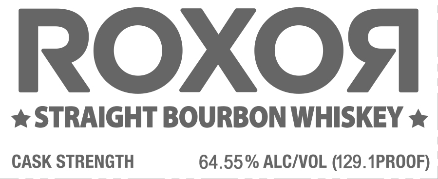
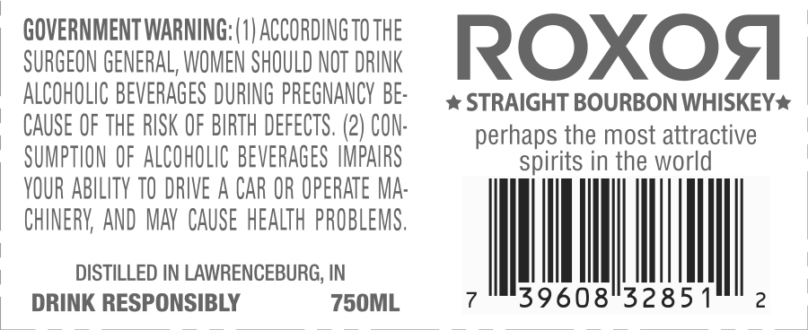
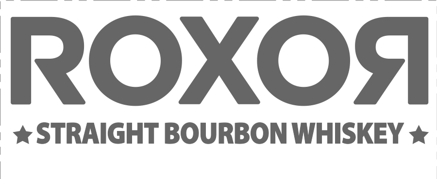
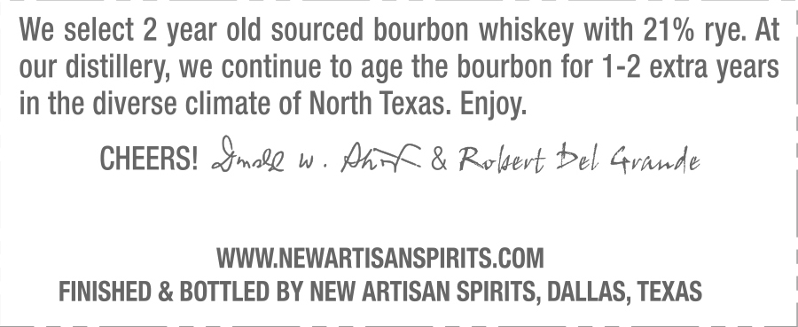

# TTB COLA Label Images - TTBID 26286001000021

**Brand Name:** ROXOR

**Fanciful Name:** CASK STRENGTH

**Issue Date:** 11/05/2026

**Origin Code:** 44

**Product Class/Type:** 101

**Source:** [TTB Public COLA Registry](https://ttbonline.gov/colasonline/viewColaDetails.do?action=publicFormDisplay&ttbid=26286001000021)

## Label Images

### Label 1

### Label 2

### Label 3

### Label 4

## Extracted Label Text

*Text extracted via OCR - may contain errors*

*1 image(s) excluded: text did not meet readability threshold*

**Detected Proof:** 129.1
**Detected Age:** 2 Years

### Label 1

ROXOA
STRAIGHT BOURBON WHISKEY
CASK STRENGTH
64.55% ALCIVOL (129. 1PROOF)

### Label 2

GOVERNMENT WARNING; (0| ACCORDING TO THE
SURGEON GENERAL, WOMEN SHOULD NOT DRINK
ROXOq
ALCOHOLIC BEVERAGES DURING PREGNANCY BE:
STRAIGHT BOURBON WHISKEY *
CAUSE OF THE RISK OF BIRTH DEFECTS. (2) CON:
perhaps the most attractive
SUMPTHON OF ALCOHOLIC BEVERAGES IMPAIRS
spirits in the world
VOUR ABILITY TO DRIVE A CAR OR OPERATe MA:
CHINERV AND  MAV  CAUSe HEALTh PROBLEMS,
DISTILLED IN LAWRENCEBURG, IN
DRINK RESPONSIBLY
750ML
39608"3285 1
2

### Label 4

We select 2 year old sourced bourbon whiskey with 21% rye. At
our
distillery; we continue to age the bourbon for 1-2 extra years
in the diverse climate of North Texas. Enjoy:
CHEERSI  malz
W
Mhvk & Rlert Pel Gvhnde
WWWNEWARTISANSPIRITS COM
FINISHED & BOTTLED BY NEW ARTISAN SPIRITS, DALLAS, TEXAS
