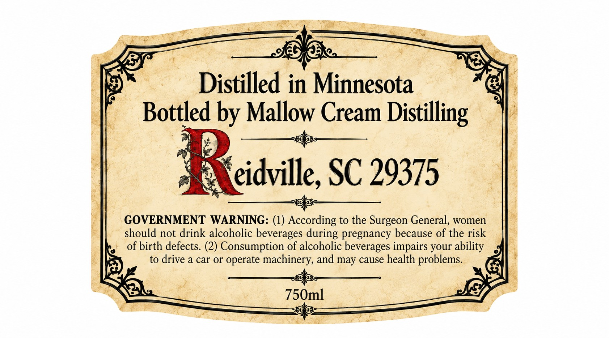
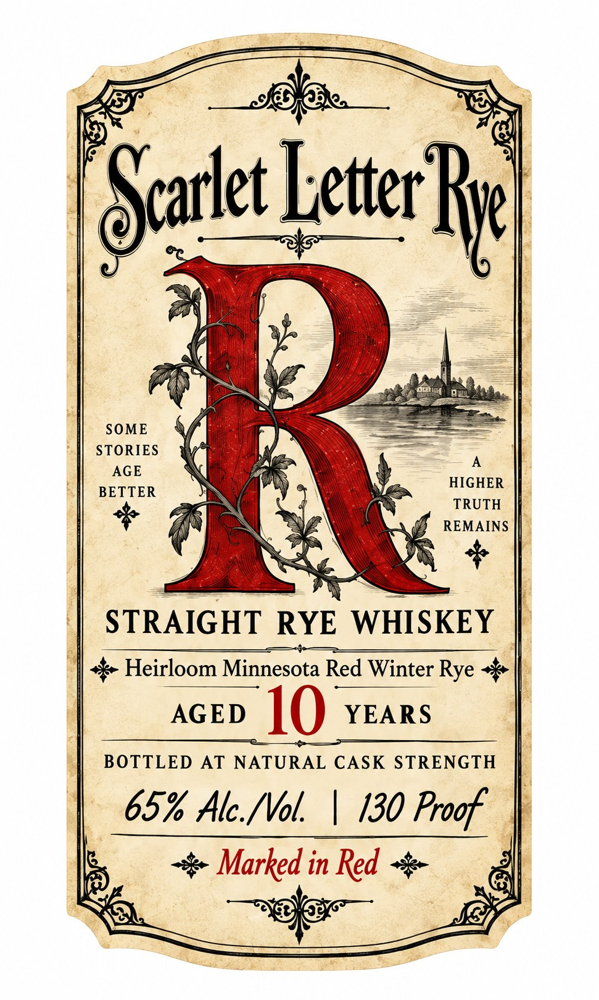

# TTB COLA Label Images - TTBID 26286001000078

**Brand Name:** SCARLET LETTER RYE

**Issue Date:** 10/19/2026

**Origin Code:** 41

**Product Class/Type:** 102

**Source:** [TTB Public COLA Registry](https://ttbonline.gov/colasonline/viewColaDetails.do?action=publicFormDisplay&ttbid=26286001000078)

## Label Images

### Back Label

### Front Label

## Extracted Label Text

*Text extracted via OCR - may contain errors*

**Detected Proof:** 130
**Detected Age:** 10 Years

### Back Label

Distilled in Minnesota
Bottled by Mallow Cream Distilling
eidville, SC 29375
GOVERNMENT WARNING: (1) According to the Surgeon General,
women
should not drink alcoholic beverages during pregnancy because of the risk
of birth defects. (2) Consumption of alcoholic beverages impairs your ability
to drive a car or operate
machinery, and may cause health problems.
750ml

### Front Label

Searket etecRe
9)
SOME
STORIES
AGE
HIGHER
BETTER
TRUTH
REMAINS
STRAIGHT
RYE WHISKEY
Heirloom Minnesota Red Winter Rye
AGED
10
YEARS
BOTTLED AT NATURAL CASK STRENGTH
65% Alc_{Vol
130 Proof
Marked in Red
