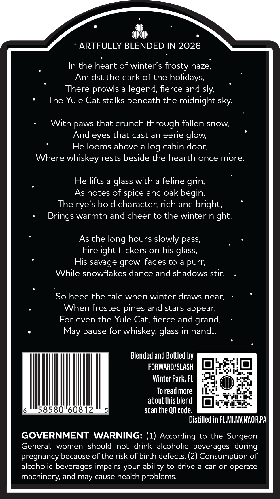
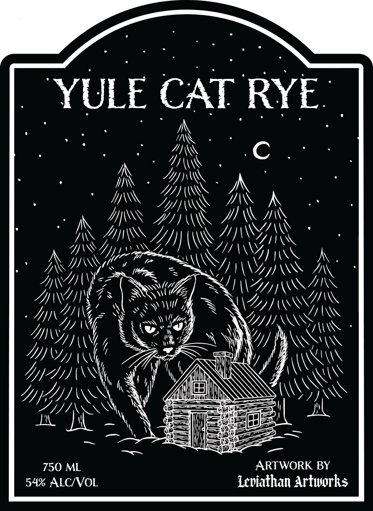
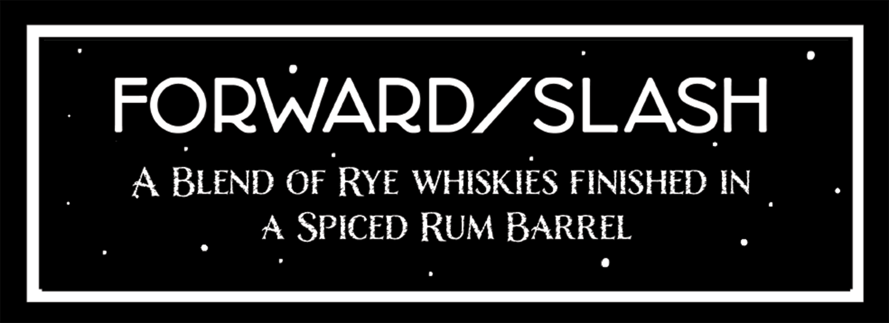

# TTB COLA Label Images - TTBID 26286001000126

**Brand Name:** YULE CAT

**Issue Date:** 10/23/2026

**Origin Code:** 16

**Product Class/Type:** 132

**Source:** [TTB Public COLA Registry](https://ttbonline.gov/colasonline/viewColaDetails.do?action=publicFormDisplay&ttbid=26286001000126)

## Label Images

### Back Label

### Front Label

### Label 2

## Extracted Label Text

*Text extracted via OCR - may contain errors*

*1 image(s) excluded: text did not meet readability threshold*

### Back Label

In the heart of winter's frosty haze,

Amidst the dark of the holidays

There prowls a legend, fierce and sly,

.

The Yule Cat stalks beneath the midnight sky.

With paws that crunch through fallen snow,

And eyes that cast an eerie glow,

He looms above a log cabin door,

Where whiskey rests beside the hearth once more

He lifts a glass with a feline grin

As notes of spice and oak begin

The rye’s bold character, rich and bright.

.

Brings warmth and cheer to the winter night

As the long hours slowly pass

Firelight flickers on his glass

His savage growl fades to a purr,

While snowflakes dance and shadows stir.

.

So heed the tale when winter draws near,

When frosted pines and stars appear,

For even the Yule Cat, fierce and grand

May pause for whiskey, glass in hand

Blended and Bottled by

FORWARD/SLASH

Winter Park, FL

To read more

il

580 60812

about this blend [eats

scan the QR code.

Distilled in FL,MI,NV,NY,OR,PA

GOVERNMENT WARNING: (1) According to the Surgeon

General, women should not drink alcoholic beverages during

pregnancy because of the risk of birth defects. (2) Consumption of

alcoholic beverages impairs your ability to drive a car or operate

machinery, and may cause health problems.

### Label 2

FORWARDZSLASH
A BLEND OF RYE WHISKIES FINISHED IN
SPICED RUM BARREL
