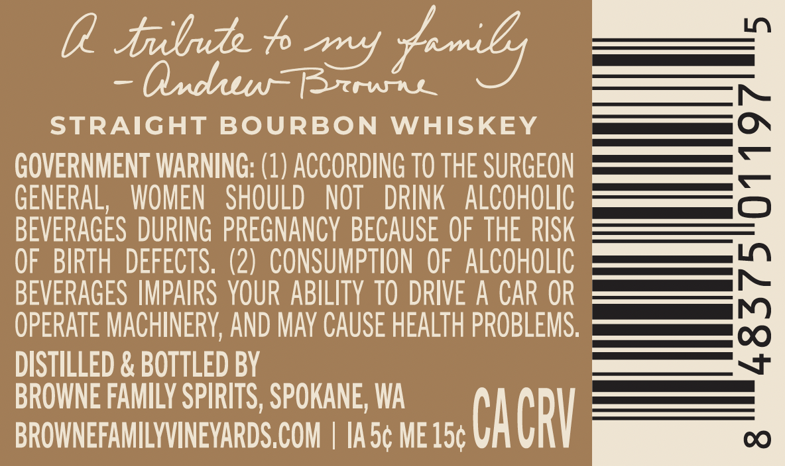
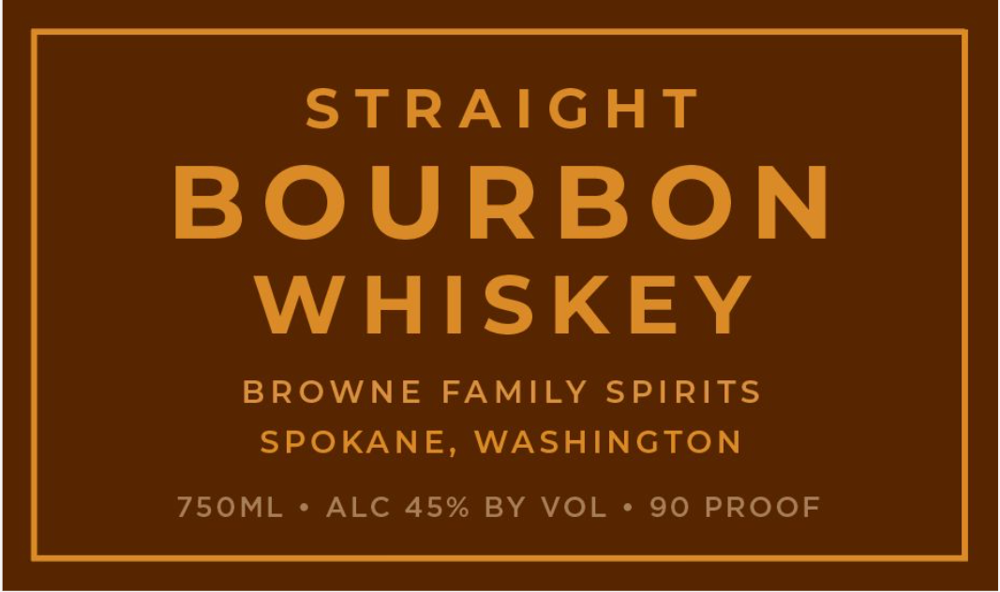
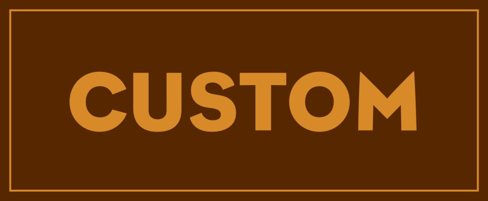

# TTB COLA Label Images - TTBID 26286001000193

**Brand Name:** BROWNE FAMILY SPIRITS

**Issue Date:** 10/20/2026

**Origin Code:** 07

**Product Class/Type:** 101

**Source:** [TTB Public COLA Registry](https://ttbonline.gov/colasonline/viewColaDetails.do?action=publicFormDisplay&ttbid=26286001000193)

## Label Images

### Back Label

### Label 1

### Label 3

## Extracted Label Text

*Text extracted via OCR - may contain errors*

*1 image(s) excluded: text did not meet readability threshold*

**Detected Proof:** 90

### Back Label

0Iubud
my
Fnilys
QxduwBrrwuu
STRAIGHT BOURBON
WHISKEY
GOVERNMENT WARNING: (1) ACCORDING TO THE SURGEON
6
GENERAL,
WOMEN
SHOULD
NOT
DRINK
ALCOHOLIC
BEVERAGES DURING  PREGNANCY  BECAUSE OF THE RISK
OF   BIRTH  DEFECTS. (2)   CONSUMPTION OF  ALCOHOLIC
BEVERAGES IMPAIRS  YOUR ABILITY TO DRIVE A CAR OR
3
OPERATE MACHINERY, AND May CAUSE HEALTH PROBLEMS:
DISTILLED & BOTTLED BY
BROWNE FAMILY SPIRITS, SPOKANE, WA
BROWNEFAMILYVINEYARDS,COM
Ia5c ME 15c
CacrV
C

### Label 1

STRAIGHT
BOURBON
WHISKEY
BROWNE
FAMILY SPIRITS
SPOKANE, WASHINGTON
750ML
ALC 45% BY VOL
90 PROOF
