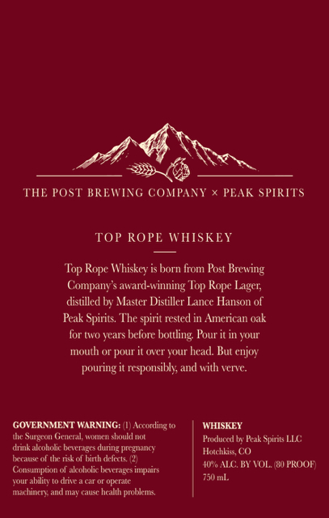
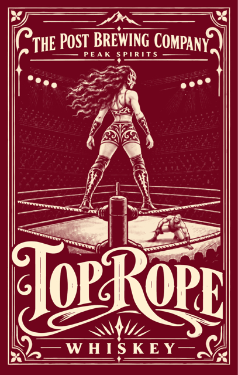

# TTB COLA Label Images - TTBID 26286001000253

**Brand Name:** PEAK SPIRITS

**Fanciful Name:** TOP ROPE WHISKEY

**Issue Date:** 10/19/2026

**Origin Code:** 13

**Product Class/Type:** 140

**Source:** [TTB Public COLA Registry](https://ttbonline.gov/colasonline/viewColaDetails.do?action=publicFormDisplay&ttbid=26286001000253)

## Label Images

### Back Label

### Front Label

## Extracted Label Text

*Text extracted via OCR - may contain errors*

### Back Label

THE POST BREWING COMPANY
PEAK SPIRITS
TOP ROPE WHISKEY
Top Rope Whiskey is born from Post Brewing
Company $ award-winning Top
distilled bwv Master Distiller Lance Hanson of
Peak Spirits: The spirit rested in American oak
for tWo years belore
Pour it in your
mouth
pour
Wl
vour hcad: But cnjoy
pouring
responsibl; and with venve:
GOVERMMENT WARNING:
According to
WHISKEY
ttc Surgcon General WOncn slould not
Produced b Rak Spirits LLC
dnnk alcoholic bctrTagcs
Dicdamc
HotchkisCO
Tcale
tkenaof binth dfts (2
#ALC BV TOL WPROOF
Conumption
alcohdlic hacrges
abdity[
dncacar
'optralc
750 ml.
machincry and may caust hcahth
problems
Rope
Laget;
bottling
nunia
Antoititg

### Front Label

i? THE POST HE POST BREWING in Comat

PEAK SPIRITS

Poe,

3 oe!

pa

wee.

Pes

PN

R

We

=

———e

al hs ——

——w

a. |

—,

Roa

x

OP RORE

Jue

WHISKEY—

<P
