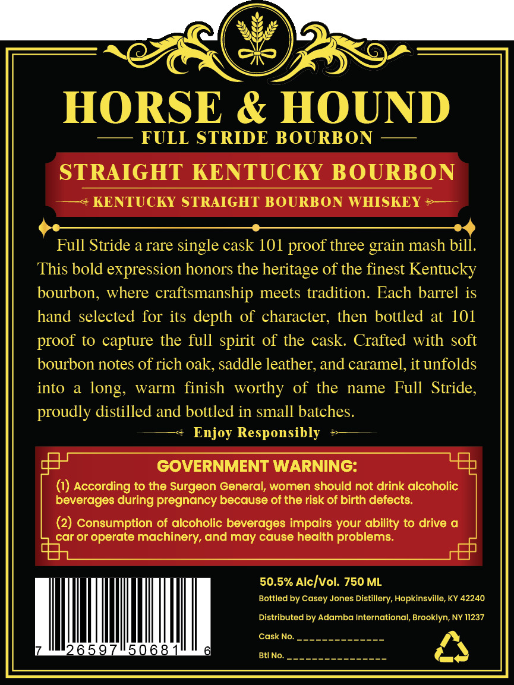
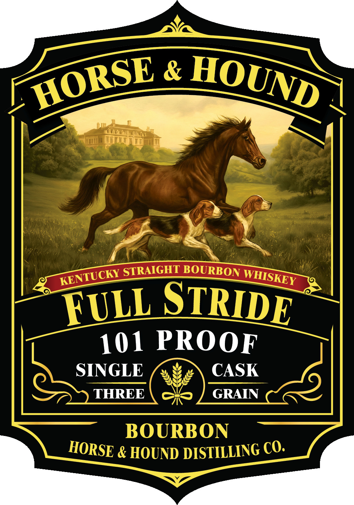

# TTB COLA Label Images - TTBID 26286001000284

**Brand Name:** HORSE AND HOUND

**Issue Date:** 10/19/2026

**Origin Code:** 22

**Product Class/Type:** 101

**Source:** [TTB Public COLA Registry](https://ttbonline.gov/colasonline/viewColaDetails.do?action=publicFormDisplay&ttbid=26286001000284)

## Label Images

### Back Label

### Front Label

## Extracted Label Text

*Text extracted via OCR - may contain errors*

**Detected Proof:** 101

### Back Label

HORSE & HOUND
FULL STRIDE BOURBON
STRAIGHT KENTUCKY BOURBON
KENTUCKY STRAIGHT BOURBON WHISKEY
Full Stride a rare single cask 101 proof three
mash bill.
This bold expression honors the heritage of the finest Kentucky
bourbon; where craftsmanship meets tradition: Each barrel is
hand selected for its depth of character, then bottled at 101
to capture the full spirit of the cask Crafted with soft
bourbon notes of rich oak, saddle leather; and caramel, it unfolds
into
a
warm finish worthy of the
name Full   Stride,
proudly distilled and bottled in small batches.
Enjoy Responsibly
GOVERNMENT WARNING:
According to the Surgeon General; women should not drink alcoholic
beverages during pregnancy because of the risk of birth defects:
(2) Consumption of alcoholic beverages impairs your ability to drive
car or operate machinery; and may cause health problems
50.5% Alc]vol: 750 ML
Bottled by Casey Jones Distillery; Hopkinsville, KY 42240
Distributed by Adamba International; Brooklyn; NY 11237
Cask No.
65.9
506.8
Btl
No.
grain
proof
long;

### Front Label

&
STRAIGHT BOURBON
FULL STRIDE
101 PROOF
SINGLE
CASK
THREE
GRAIN
BOURBON
& HOUND DISTILLING CO._
HORSE
HOUND
KENTUCKY
WHISKEY
HORSE
