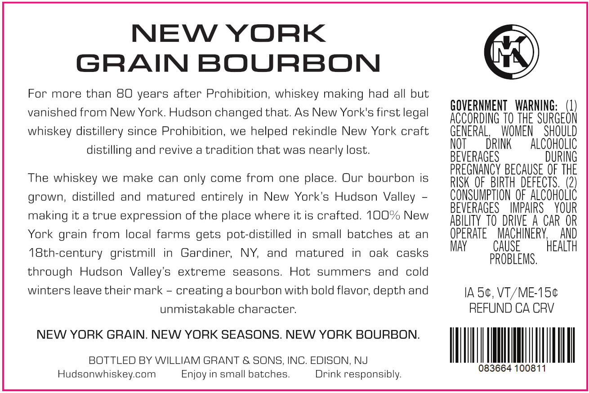
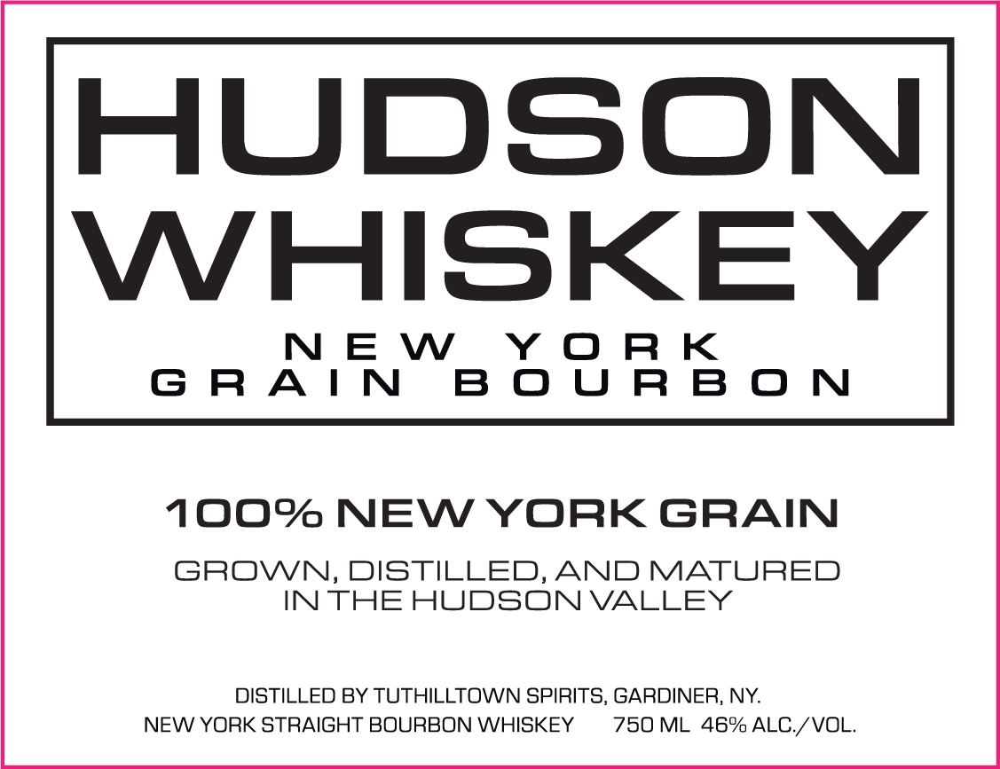

# TTB COLA Label Images - TTBID 26286001000327

**Brand Name:** HUDSON WHISKEY

**Fanciful Name:** NEW YORK GRAIN BOURBON

**Issue Date:** 10/26/2026

**Origin Code:** 03

**Product Class/Type:** 101

**Source:** [TTB Public COLA Registry](https://ttbonline.gov/colasonline/viewColaDetails.do?action=publicFormDisplay&ttbid=26286001000327)

## Label Images

### Back Label

### Label 1

## Extracted Label Text

*Text extracted via OCR - may contain errors*

**Detected Proof:** 92

### Back Label

NEW YORK
GRAIN BOURBON
For more than 80 years after Prohibition, whiskey making had all but
vanished from
York Hudson changed that
As New York's first legal
GOVERNMENT   WARNING:   (1)
ACCORDING TO THE SURGEON
whiskey distillery since Prohibition, we helped rekindle New York craft
GENERAL;
WOMEN
SHOULD
distilling and revive a tradition that was nearly lost_
NOT
DRINK
AlCoHOLIC
BEVERAGES
DURING
PREGNANCY BECAUSE OF THE
The whiskey we make can only come from
one place:
Our bourbon is
RISK OF_BIRTH  defects  (2)
grown; distilled
and
matured entirely in
New York's Hudson Valley
CONSUMPTHON €F ALCoHOLIc
BEVERAGES
IMPAIRS
YOUR
making it a true expression of the place where it is crafted. 1O0% New
ABILITY TO  DRIVE  A CAR OR
York grain from local farms gets pot-distilled in
small batches
at
an
OPERATE
MACHINERY
AND
MAY
CAUSE
HEALTH
18th-century gristmill in
Gardiner;
NY,
and
matured
in
oak
casks
PROBLEMS .
through Hudson  Valley's
extreme
seasons.
Hot summers
and
cold
winters leave their mark
creating
bourbon with bold
depth and
IA 5c, VT/ME1S4
unmistakable character:
REFUND CA CRV
NEW YORK GRAIN. NEW YORK SEASONS. NEW YORK BOURBON.
BOTTLED BY WILLIAM GRANT & SONS, INC. EDISON, NJ
083664 100811
Hudsonwhiskey com
Enjoy in small batches
Drink responsibly:
New
flavor;

### Label 1

HUDSON

WHISKEY

NEW YORK

GRAIN BOURBON

100% NEW YORK GRAIN

GROWN, DISTILLED, AND MATURED

IN THE HUDSON VALLEY

NEW YORK STRAIGHT BOURBON WHISKEY

DISTILLED BY TUTHILLTOWN SPIRITS, GARDINER, NY.

750 ML 46% ALC./VOL.
