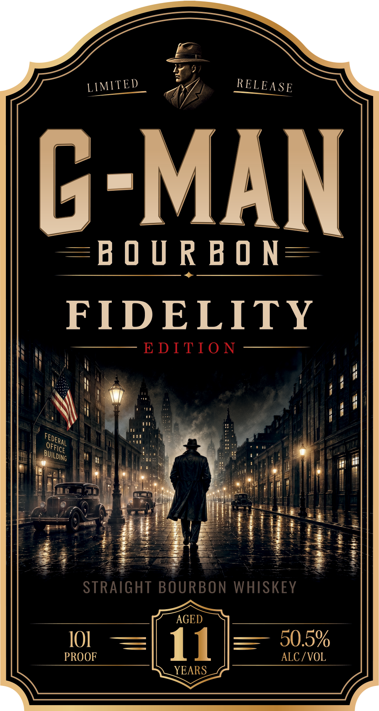
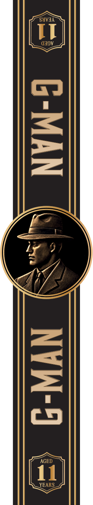

# TTB COLA Label Images - TTBID 26286001000482

**Brand Name:** GMAN

**Issue Date:** 11/04/2026

**Origin Code:** 16

**Product Class/Type:** 101

**Source:** [TTB Public COLA Registry](https://ttbonline.gov/colasonline/viewColaDetails.do?action=publicFormDisplay&ttbid=26286001000482)

## Label Images

### Back Label

### Front Label

### Label 2

## Extracted Label Text

*Text extracted via OCR - may contain errors*

*1 image(s) excluded: text did not meet readability threshold*

**Detected Proof:** 101

### Back Label

FIDELITY
EDITIO N
Inspired by the enduring principles of Fidelity
Bravery, and Integrity, G-Man Bourbon pays tribute
to
those who have dedicated their lives t0 service,
stood firm in the face 0f adversity, and remained
faithful to something greater than themselves:
Itreflects our belief that some things are worth the
wait, and that true character
-like a
lasting
legacy--isbuilt over time.
G-Man Fidelityis the first release in our Legacy
Series, honoring the traditions, character; and
commitment that define the G-Man spirit:
PROUD
TO
SERVE
GMANBOURBON.COM
Produced by G-Man Spirits
750ML
Bottled by Artifact Spirits; Winter Park, FL
Distilled in Indiana
GOVERNMENT
WARNING:
(1) According to the
Surgeon General, women should not drink alcoholic
beverages during pregnancy because of the risk of
birth
defects;
(2)
Consumption
of
alcoholic
beverages impairs your ability to drive
car
or
operate machinery; and may cause health problems;

### Front Label

C-MAN
EB 0 U R B 0 N
FIDELITY
E DITI0 N
STRAIGHT BOURBON WHISKEY
AGED
10]
11
50.5%
PROOF
ALC / VOL
YEARS
LIMITED
RELEASE
FEDERAL
OFFICE
building
