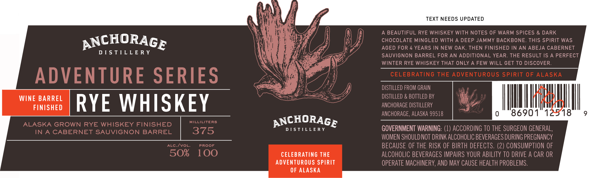

# TTB COLA Label Images - TTBID 26286001000574

**Brand Name:** ANCHORAGE DISTILLERY

**Fanciful Name:** ADVENTURE SERIES

**Issue Date:** 10/21/2026

**Origin Code:** 4E

**Product Class/Type:** 142

**Source:** [TTB Public COLA Registry](https://ttbonline.gov/colasonline/viewColaDetails.do?action=publicFormDisplay&ttbid=26286001000574)

## Label Images

### Label 1

### Label 2

## Extracted Label Text

*Text extracted via OCR - may contain errors*

*1 image(s) excluded: text did not meet readability threshold*

**Detected Proof:** 100
**Detected Age:** 4 Years

### Label 1

TEXT NEEDS UPDATED
A BEAUTIFUL RYE WHISKEY WITH NOTES OF WARM SPICES & DARK
ANCHORAGE
CHOCOLATE MINGLED WITH A DEEP JAMMY BACKBONE
THIS SPIRIT WAS
AGED FOR 4 YEARS IN NEW OAK, THEN FINISHED IN AN ABEJA CABERNET
D [ S TILL E R y
SAUVIGNON BARREL FOR AN ADDITIONAL YEAR_
THE RESULT IS
A PERFECT
WINTER RYE WHISKEY THAT ONLY
A FEW WILL GET TO DISCOVER
ADVENTURE SERIES
CELEBRATING THE ADVENTUROUS SPIRIT 0F ALASKA
DISTILLED FROM GRAIN
WINE BARREL
DISTILLED & BOTTLED BV
FINISHED
RYE WHISKEY
ANCHORAGE DISTILLERY
ANCHORAGE, ALASKA 99518
86901
518
ALASKA GROWN RYE WHISKEY FINISHED
MILLILITERS
ANCHORAGE
IN
CABERNET SAUVIGNON
BARREL
375
D [ 5 TILLE R y
GOVERNMENT WARNING: (1) ACCORDING TO THE SURGEON GENERAL,
WOMEN SHOULD NOT DRINK ALCOHOLIC BEVERAGES DURING PREGNANCY
ALC Ivol:
PRooF
BECAUSE OF THE RISK OF BIRTH DEFECTS. (2) CONSUMPTION OF
50%
100
CELEBRATING THE
ALCOHOLIC BEVERAGES IMPAIRS YOUR ABILITY TO DRIVE A CAR OR
ADVENTUROUS SPIRIT
OPERATE MACHINERY, AND May CAUSE HEALTH PROBLEMS.
OF ALASKA
