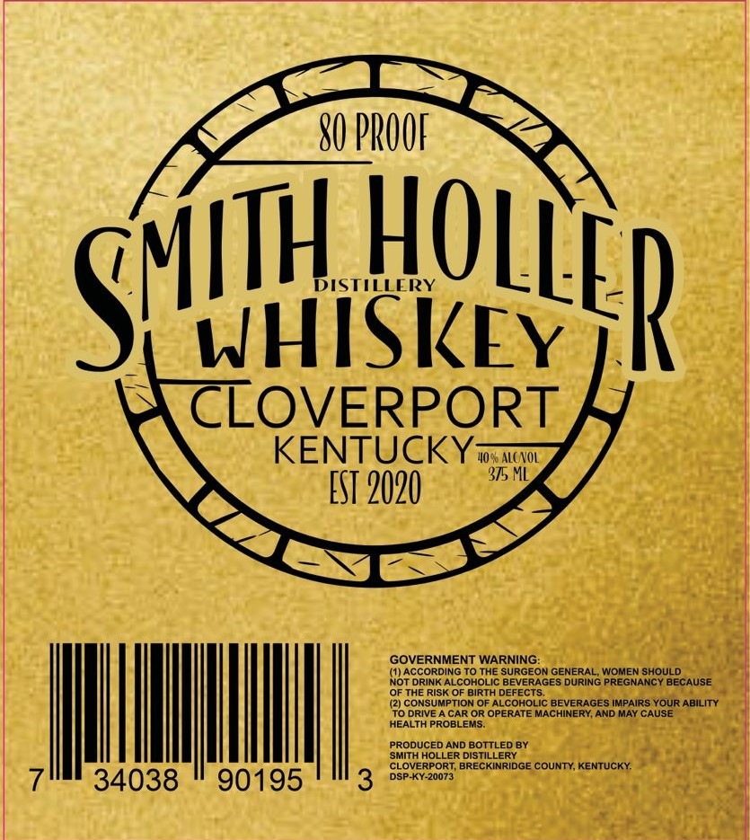

# TTB COLA Label Images - TTBID 26286001000618

**Brand Name:** SMITH HOLLER DISTILLERY

**Issue Date:** 10/23/2026

**Origin Code:** 22

**Product Class/Type:** 140

**Source:** [TTB Public COLA Registry](https://ttbonline.gov/colasonline/viewColaDetails.do?action=publicFormDisplay&ttbid=26286001000618)

## Label Images

### Label 1

## Extracted Label Text

*Text extracted via OCR - may contain errors*

**Detected Proof:** 80

### Label 1

80 PROUF
DISTILLERY
WHISKEY
CLOVERPORT
KENTUCKY-
40 % Alc NOL
375 ML
EST 2020
GOVERNMENT WARNING:
(1)ACCORDING TO THE SURGEON GENERAL; WOMEN SHOULD
NOT DRINK ALCOHOLIC BEVERAGES DURING PREGNANCY BECAUSE
OF THE RISK OF BIRTH DEFECTS.
(2) CONSUMPTION OF ALCOHOLIC BEVERAGES IMPAIRS YOUR ABILITY
TO DRIVE
CAR OR OPERATE MACHINERY; AND MAY CAUSE
HEALTH PROBLEMS:
PRODUCED AND BOTTLED BY
SMIth HOLLER DISTILLERY
CLOVERPORT; BRECKINRIDGE COUNTY; KENTUCKY:
34038
90195
3
DSP-KY-20073
HOLLER
SMIH
