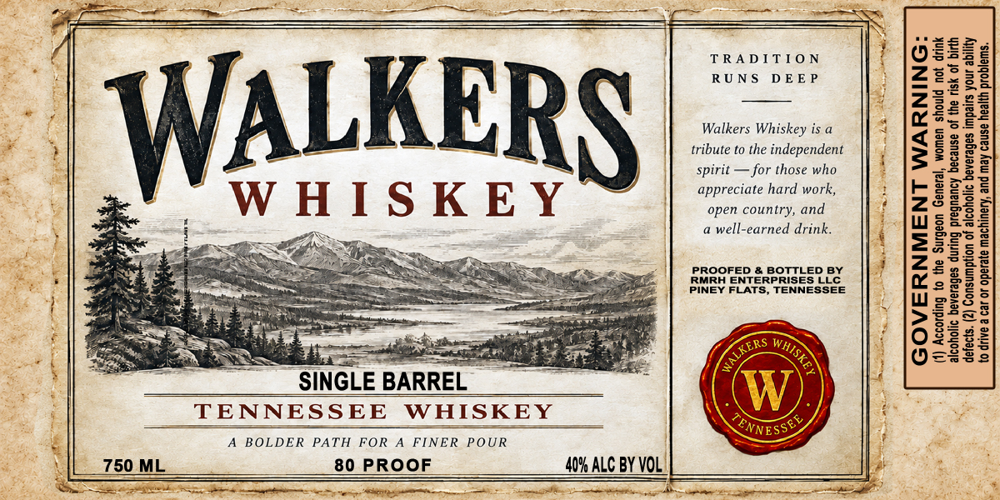

# TTB COLA Label Images - TTBID 26286001000631

**Brand Name:** WALKERS WHISKEY

**Issue Date:** 10/20/2026

**Origin Code:** 43

**Product Class/Type:** 140

**Source:** [TTB Public COLA Registry](https://ttbonline.gov/colasonline/viewColaDetails.do?action=publicFormDisplay&ttbid=26286001000631)

## Label Images

### Label 1

## Extracted Label Text

*Text extracted via OCR - may contain errors*

**Detected Proof:** 80

### Label 1

as dt 2 = =
~ SINGLE BARREL

TENNESSEE WHISKEY

A BOLDER PATH FOR A FINER POUR

80 PROOF 40% ALC BY VOL

TRADITION
RUNS DEEP

Walkers Whiskey is a
tribute to the independent
spirit — for those who
appreciate hard work,
open country, and
a well-earned drink.

PROOFED & BOTTLED BY
RMRH ENTERPRISES LLC
PINEY FLATS, TENNESSEE

ne LS ST ae

Consumption of alcoholic beverages impairs your
to drive a car or operate machinery, and may cause health problems.

(1) According to the Surgeon General, women should not drink
alcoholic beverages during pregnancy because of the risk of birth

GOVERNMENT WARNING
