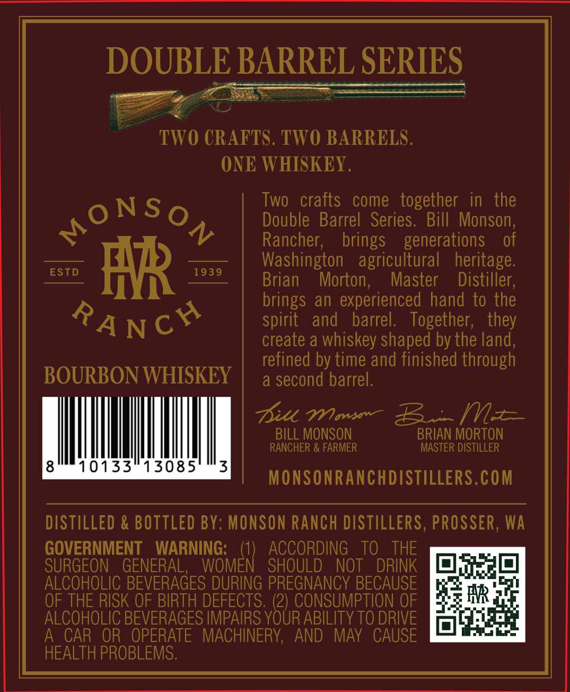
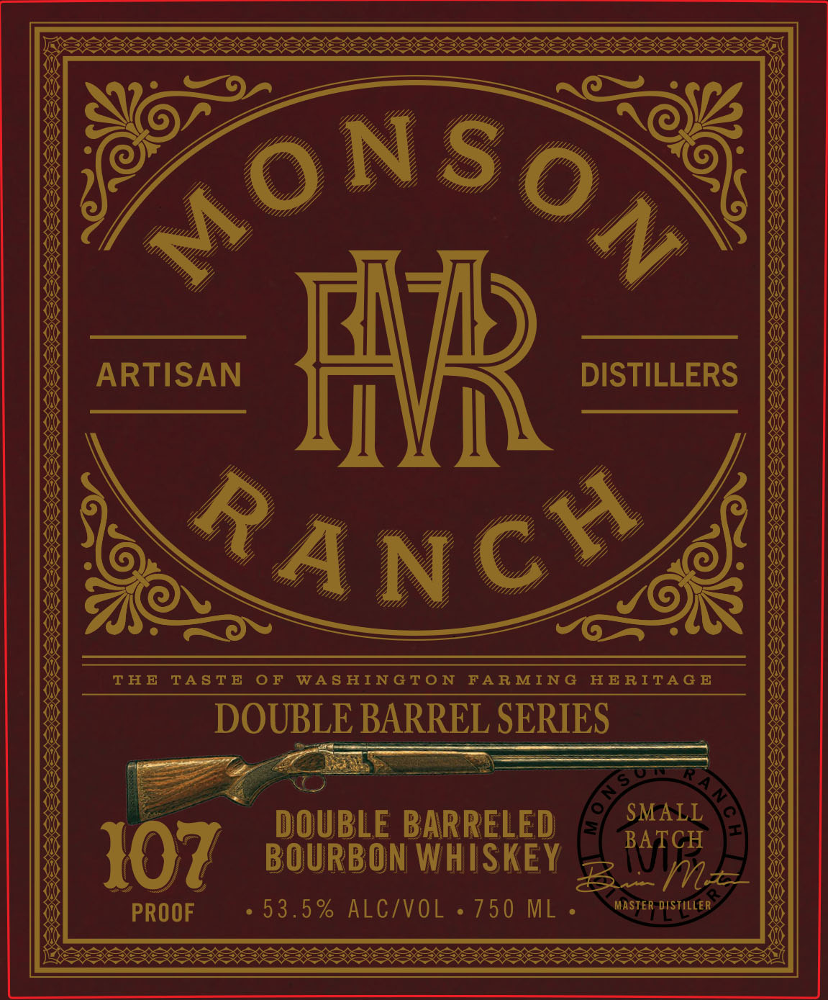

# TTB COLA Label Images - TTBID 26286001000698

**Brand Name:** MONSON RANCH

**Issue Date:** 10/23/2026

**Origin Code:** 07

**Product Class/Type:** 141

**Source:** [TTB Public COLA Registry](https://ttbonline.gov/colasonline/viewColaDetails.do?action=publicFormDisplay&ttbid=26286001000698)

## Label Images

### Back Label

### Label 1

### Label 2

## Extracted Label Text

*Text extracted via OCR - may contain errors*

*2 image(s) excluded: text did not meet readability threshold*

### Back Label

DOUBLE BARREL SERIES

Soe

er

TWO CRAFTS. TWO BARRELS

ONE WHISKEY

Two crafts come together in the

ONSo

Double Barrel Series. Bill Monson

Rancher

brings generations of

ESTD

1939)

Washington agricultural

heritage

Brian

Morton

Master

Distiller

AR

brings an experienced hand to the

spirit and barrel

Together, they

create a whiskey shaped by the land

BOURBON WHISKEY

refined by time and finished through

a second barrel

oo

Dill. Waves

BILL MONSON

BRIAN MORTON

a

RANCHER & FARMER

MASTER DISTILLER

10133°13085

MONSONRANCHDISTILLERS.COM

DISTILLED & BOTTLED BY: MONSON RANCH DISTILLERS, PROSSER, WA

GOVERNMENT WARNING:

ACCORDING TO THE

SURGEON GENERAL, WOM

fs

SHOULD NOT DRINK

OFF

Fal

10]

ALCOHOLIC BEVERAGES DURING PREGNANCY BECAUSE

OF THE RISK OF BIRTH DEFECTS. (2) CONSUMPTION OF

nn

ALCOHOLIC BEVERAGES IMPAIRS YOUR ABILITY TO DRIVE

ope

it fore

A CAR OR OPERATE MACHINERY, AND MAY CAUSE

HEALTH PROBLEMS
