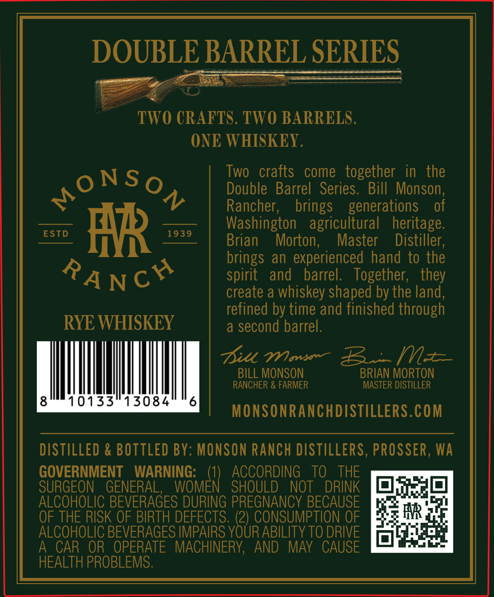
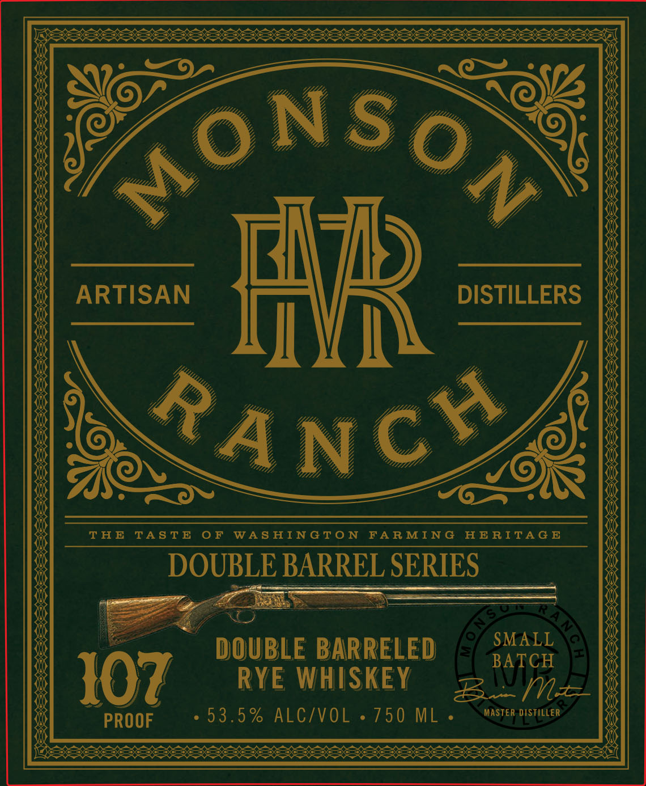
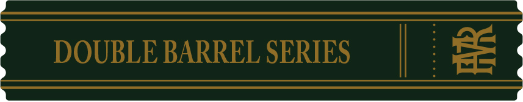

# TTB COLA Label Images - TTBID 26286001000701

**Brand Name:** MONSON RANCH

**Issue Date:** 10/21/2026

**Origin Code:** 07

**Product Class/Type:** 142

**Source:** [TTB Public COLA Registry](https://ttbonline.gov/colasonline/viewColaDetails.do?action=publicFormDisplay&ttbid=26286001000701)

## Label Images

### Back Label

### Label 1

### Label 3

## Extracted Label Text

*Text extracted via OCR - may contain errors*

*1 image(s) excluded: text did not meet readability threshold*

### Back Label

SOUS UE ING ets

ee

a

TWO CRAFTS. TWO BARRELS

ONE WHISKEY

Two crafts come together in the

ONSo

Double Barrel Series. Bill Monson

Rancher

of

brings generations

ESTD

1939

Washington agricultural heritage

AR

Brian

Morton

Master

Distiller

brings an experienced hand to the

spirit and barrel

Together

they

create a whiskey shaped by the land

refined by time and finished through

RYE WHISKEY

a second barrel

Pit Wancse—

(LE

BILL MONSON

BRIAN MORTON

RANCHER & FARMER

MASTER DISTILLER

8

10133°13084

6

MONSONRANCHDISTILLERS.COM

DISTILLED & BOTTLED BY: MONSON RANCH DISTILLERS, PROSSER, WA

GOVERNMENT WARNING

1) ACCORDING TO THE

SURGEON GENERAL, WOMEN SHOULD NOT DRINK

ae

ALCOHOLIC BEVERAGES DURING PREGNANCY BECAUSE

OF THE RISK OF BIRTH DEFECTS. (2) CONSUMPTION OF

iS AR

ALCOHOLIC BEVERAGES IMPAIRS YOUR ABILITY TO DRIVE

reign

A_CAR OR OPERATE MACHINERY, AND MAY CAUSE

HEALTH PROBLEMS

### Label 1

ARTISAN
Hb
DISTILLERS
RANCH
THE
TASTE
0 F
WA8 HINGTO N
FAR MING
HE RITA G E
DOUBLE BARREL SERIES
F
SMALL
DOUBLE BARRELED
BATCH
107
RYE WHISKEY
E~m
PROOF
5 3 . 5 % ALC/VOL
750 ML
MASTER DISTiLLER
MONS
0 N
HAM
