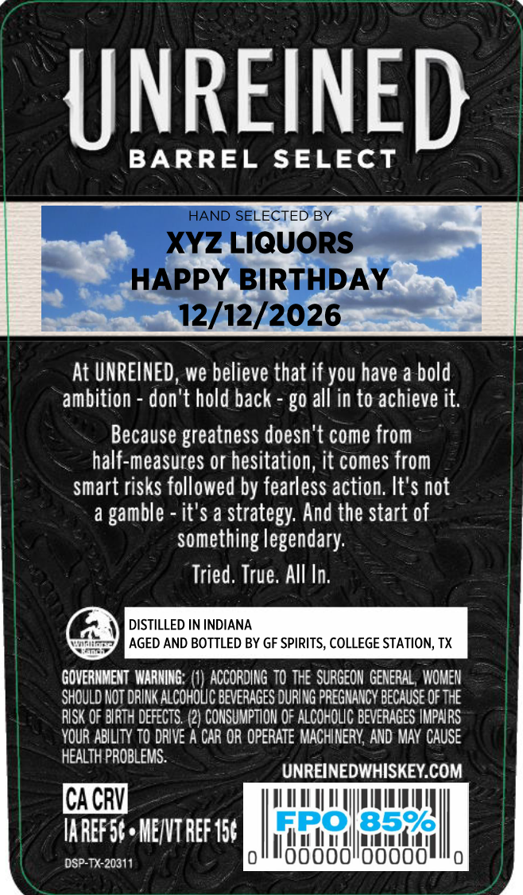
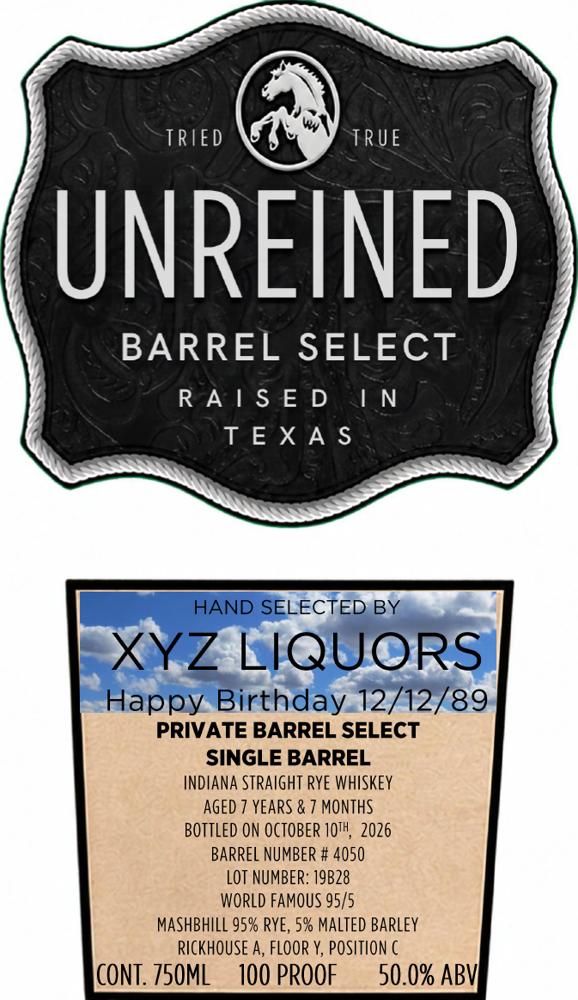

# TTB COLA Label Images - TTBID 26286001000708

**Brand Name:** UNREINED

**Fanciful Name:** BARREL SELECT

**Issue Date:** 10/19/2026

**Origin Code:** 44

**Product Class/Type:** 102

**Source:** [TTB Public COLA Registry](https://ttbonline.gov/colasonline/viewColaDetails.do?action=publicFormDisplay&ttbid=26286001000708)

## Label Images

### Back Label

### Front Label

### Label 3

## Extracted Label Text

*Text extracted via OCR - may contain errors*

*1 image(s) excluded: text did not meet readability threshold*

**Detected Proof:** 100
**Detected Age:** 7 Years

### Back Label

UNREINED
BARREL
SELECT
HAND SELECTED BY
XYZ LIQUORS
HAPPY BIRTHDAY
12/12/2026
At UNREINED, we believe that if you have a bold
ambition
don't hold back - go all in to achieve it,
Because greatness doesn't come from
half-measures or hesitation, it comes from
smart risks followed by fearless action. It'$ not
a
gamble - it'$ a strategy: And the start of
something legendary:
Tried. True. AlI In.
DISTILLED IN INDIANA
AGED AND BOTTLED BY GF SPIRITS, COLLEGE STATION; TX
GOVERNMENT WARMING: (1) ACCORDING TO THE  SURGEOH GENERAL , WOMEN
SHOULD NOT DRINK Alcohouc BEVERAGES DURING PREGHANCV BeCauSE Of ThE
RISK OF bIRTH DEFECTS, (2) CONSUMPTLON OF ALCOHOLIC BEVERAGES IMPARS
YOUR ABILITY tTO DRIVE A CAR OR OPERATE MACHINERY; AND MAY CAUSE
HEALTH PROBLEMS:
UNREINEDWHISKEY.COM
CACR
MREF56 , MENVT ReF 156
GBO18526
DSP-TX-20311
ooooidooo

### Front Label

SSN

ESN

SS SS

TRIED

TRUE

UNREINED

BARREL SELECT

RAISED

IN

TEXAS

HAND SELECTED, BY

XYZ LlQUORS

Happy Birthday.12/12/89

PRIVATE BARREL SELECT

SINGLE BARREL

INDIANA STRAIGHT RYE WHISKEY

AGED 7 YEARS & 7 MONTHS

BOTTLED ON OCTOBER 10", 2026

BARREL NUMBER # 4050

LOT NUMBER: 1928

WORLD FAMOUS 95/5

MASHBHILL 95% RYE, 5% MALTED BARLEY

RICKHOUSE A, FLOOR Y, POSITION C

CONT. 750ML

100 PROOF

50.0% ABV}
