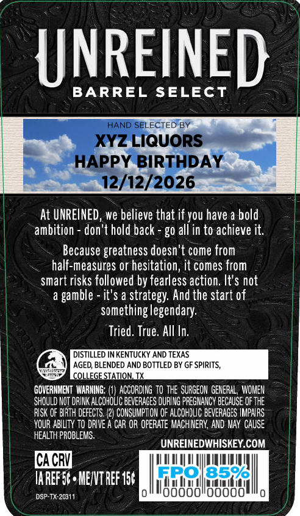
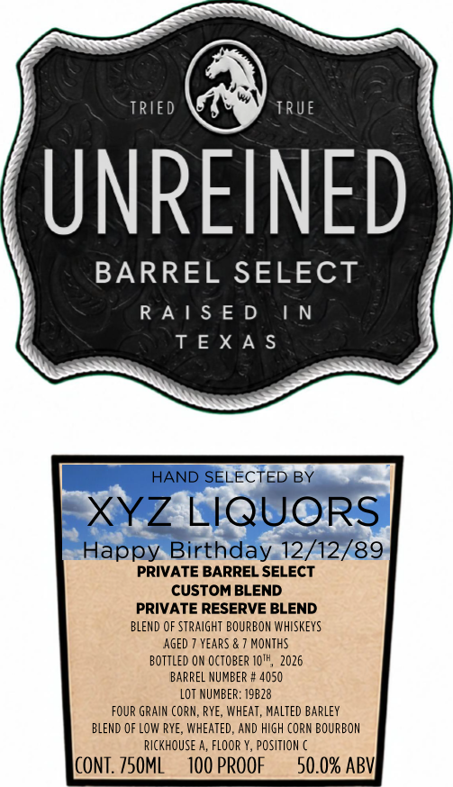

# TTB COLA Label Images - TTBID 26286001000711

**Brand Name:** UNREINED

**Fanciful Name:** BARREL SELECT

**Issue Date:** 10/19/2026

**Origin Code:** 44

**Product Class/Type:** 121

**Source:** [TTB Public COLA Registry](https://ttbonline.gov/colasonline/viewColaDetails.do?action=publicFormDisplay&ttbid=26286001000711)

## Label Images

### Back Label

### Front Label

### Label 3

## Extracted Label Text

*Text extracted via OCR - may contain errors*

*1 image(s) excluded: text did not meet readability threshold*

**Detected Proof:** 100

### Back Label

UNREINED
BARREL SELECT
HAND SELECTED BY
XYZ LIQUORS
HAPPY BIRTHDAY
12/12/2026
At UNREINED, we believe that if you have a bold
ambition
don't hold back
g0 all in to achieve it.
Because greatness doesn't come from
half-measures or hesitation, it comes from
smart risks followed by fearless action. It'$ not
it'$ a strategy: And the start of
something legendary:
Tried, True. AlI In;
DISTILLED N KENTUCKY AND TEXAS
AGED BLENDED AND BOTTLED BY GF SPIRITS,
COLLEGE SIATION IX
GOVERHMENT  WARNING;
ACCORDING to the  SURGEON  GENERAL , WOMEN
SHOULD NOT DRINK ALCOhOLC BEVERAGES DURLNG PFEGMANCY BECHUSE OF THE
RlSK OF BIRTH deFECTS  /2) COHSUMPTTON 0F ALCOHLIC BEvERaGES IMPNRS
YOUR ABILTY tO dRIVE
CAR OR OPERATE MACHINERY,  AND MAY  CAUSE
HEALTH PROBLEMS
UNREINEDWHISKEY.COM
CACR
Iaref%6 , MENVT REF 156
ERO
8596
DSP-TX-20311
oooooidooo
gamble

### Front Label

TrIed
TRUE
UNREINED
BARREL SELECT
R A | $ E D
N
T EX A $
HAND SELECTED BY
XYZ LIQUORS
Happy Birthday 12/12/89
PRIVATE BARREL SELECT
CUSTOM BLEND
PRIVATE RESERVE BLEND
BLEND OF STRaIGHT BOURBON WHISKEYS
AGED
YEARS
MOnTHS
Bottled ON OCTOBER IQTH, 2026
BARREL NUMBER # 4050
LoT NUMBER: 19B28
FOUR GRAIn CORN; RYE , WHEAT, Malted Barley
BLEND OF LoW RyE, WHEATED, AND HIgh CORN BOURBON
RickhOUSE a, FlooR Y, Position
CONT: Z5OML
100 PROOF
50.0% ABV
