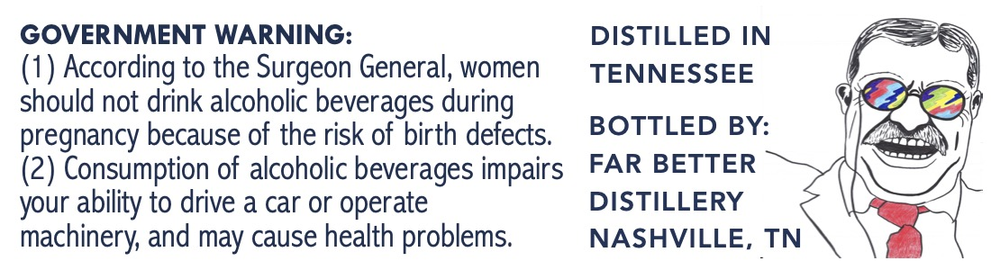
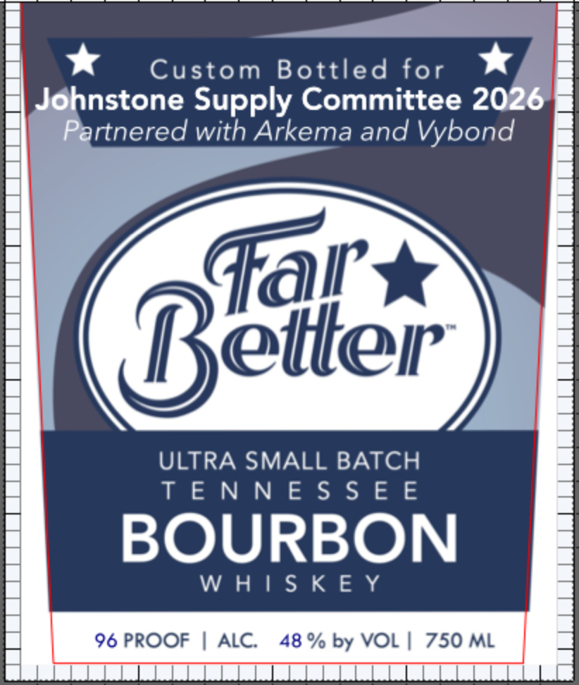

# TTB COLA Label Images - TTBID 26286001000714

**Brand Name:** FAR BETTER

**Issue Date:** 10/21/2026

**Origin Code:** 43

**Product Class/Type:** 141

**Source:** [TTB Public COLA Registry](https://ttbonline.gov/colasonline/viewColaDetails.do?action=publicFormDisplay&ttbid=26286001000714)

## Label Images

### Back Label

### Label 1

## Extracted Label Text

*Text extracted via OCR - may contain errors*

### Back Label

GOVERNMENT WARNING:
DISTILLED IN
(1) According to the Surgeon General, women
TENNESSEE
should not drink alcoholic beverages during
pregnancy because of the risk of birth defects.
BOTTLED BY:
(2) Consumption of alcoholic beverages impairs
FAR BETTER
your ability to drive a car or operate
DISTILLERY
machinery and may cause health problems
NASHVILLE, TN

### Label 1

—

*

Custom Bottled for

*

nstone Supply Committee 2026

rtnered with Arkema and Vybond

Fal *

ter

ULTRA SMALL BATCH

TENNESSEE

BOURBON

WHISKEY
